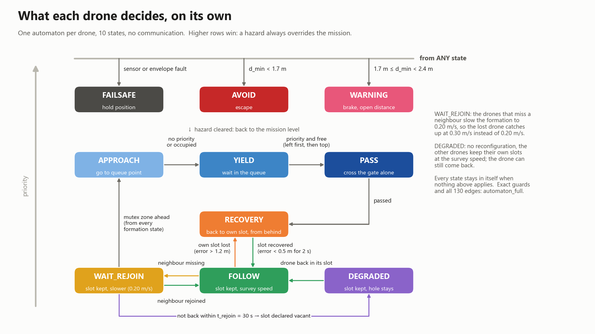

# HoloHybridAutomaton

Decentralised control of BlueROV2 fleets in HoloOcean: the same local hybrid automaton on every vehicle, passive one-way acoustic
beacons between vehicles. Three properties are checked with Z3 on abstractions, on the deployed code by enumeration, and in
simulation by a referee that judges every run from ground truth.



## 1. Scope

One local hybrid automaton per vehicle (10 modes, prioritised guards, `holo_fleet/ha/spec.py`) runs on six single-beam
sonars, DVL, IMU, compass, depth sensor, the mission plan shared before the dive and the acoustic receptions. There is no
leader and no request, reply or command between vehicles. Every gate carries a fixed acoustic pinger at a surveyed position
(the gate beacon, infrastructure of the mission map like the gate beacons of the Marine Race Arena); B0 and B2 both receive it.

- **P1, separation:** the centre distance of every pair stays strictly above `d_safe` = 1.0 m.
- **P2, mutual exclusion:** at most one vehicle in the critical region (CR) of a gate, and only after admission.
- **P3, eventual formation recovery:** the healthy communicating fleet eventually re-enters the declared formation tolerance
  after a temporary disturbance. This is the target contract. The proofs below cover specified tracking and clock regimes.
  Permanent failures and indefinite acoustic silence have separate degraded behaviour with no fleet recovery guarantee.

**Controller.** B2 (the automaton with passive one-way acoustic beacons) is the controller. B0 is the same controller with the
communication disabled (`config.communication_disabled`; only `beacon.mode` differs, `tests/test_single_controller.py`), a baseline
for the paper. No other variant exists in the code.

**Operating domain** (declared in `holo_fleet/config.py`, `sim/sensor_noise.py`, `scope.py`). Outside it no property is claimed;
the controller logs which property it can no longer certify.

- 2 to 4 vehicles at one gate: abreast queues of 2 or 3, stacked 2 x 2, a 3-vehicle stack pair. Abreast queues of 4 or more
  are refused when the plan is loaded (`queue_lateral_max` = 3.5 m). `formation_six` (6 vehicles) is simulated only.
- Horizontal current inside the control-feasible envelope (`control/current_envelope.py`, validated to 0.6 m/s), vertical
  current at most 0.25 m/s, unrejected drift at most 0.15 m/s per axis (P1, P2 filter), residual disturbance at most 0.05 m/s
  once the integrator has converged (P3; the proof margin vanishes at 0.064 m/s, `config/parameter_sources.json`).
- Navigation error at most `nav_err_m` = 1.0 m per axis in the gate frame; depth -9.0 to -1.5 m; braking at least 0.5 m/s^2;
  nominal speed at most 0.5 m/s. Acoustic envelope: the former MEDIUM channel (now `MEDIUM_HARSH`) at 3 sigma (`AcousticConfig`), latency at most 0.40 s,
  clock skew at most 0.05 s, TDMA period 1 s.
- The receiver validates capture time and numeric integrity before use. Maximum onboard ages are 0.25 s for sonar and IMU,
  0.20 s for compass and depth, and 0.35 s for DVL health. The DVL velocity-loop freshness is stricter at 0.15 s. The sensor
  rates are 10 Hz (sonar, DVL) and 30 Hz (IMU, compass, depth). Missing or invalid data cannot refresh a measurement.
- CLEAN, LOW, MEDIUM and HIGH are simulation profiles. LOW and MEDIUM are realistic nominal levels from sensor datasheets and the
  literature (sonar shift truncated at one bin, per-run sonar sound-speed and DVL scale factors; acoustic LOW / MEDIUM likewise,
  the former MEDIUM channel kept as `MEDIUM_HARSH`); sources per value in `config/parameter_sources.json`. MEDIUM's Gaussian jitter and independent fades do not impose hard
  bounds on range error or consecutive misses. The formal operating domain requires the independently declared range-error,
  tilt, capture and actuator premises at use. See the sensor-specific sources and bias budget in `config/parameter_sources.json`.
  HIGH is a stress profile.
- Permanent failures only outside the exclusion zone of the gate (`holo_fleet/scope.py`) and never inside the CR: one failure
  for 2 vehicles (none while committed), at most n - 2 for n >= 3.

The deterministic checks distinguish a hard premise from a simulator noise parameter. Rates and receiver ages above are
runtime limits. A valid timestamp alone does not establish the error bound or detect a faded return.

| Stream | Error model used to evaluate the physical premises |
|---|---|
| Six sonars | 0.05 m bins; range residual in [-0.08, +0.12] m for valid obstacle returns; hull geometry and relative tilt at most 10 deg in the nearest-distance abstraction. A recent echo must cover the threatening pair. |
| DVL | Ground-referenced velocity with valid bottom lock. The navigation model budgets 1% scale error, 0.0285 m/s body-frame noise scale and a separate outage term. The scale is statistical evidence. Persistent additive bias must be independently bounded or corrected for relative holding. |
| IMU | CLEAN acceleration and angular-rate noise scales of 0.01 m/s² and 0.005 rad/s at 30 Hz. Used to screen valid samples and for heading-rate feedback. Acceleration observations alone cannot bound the position error of a steady drift. |
| Compass | CLEAN per-axis noise scale 0.005; heading error enters the navigation and acoustic budgets, including bias. Tilt and field anomalies can exceed those budgets. |
| Pressure depth | CLEAN noise scale 0.02 m, with 0.45 m depth allowance in the navigation budget. A lost pressure stream widens the vertical position bound. |
| B2 passive acoustic | TDMA period 1 s, admission latency bound 0.40 s and admission-clock skew bound 0.05 s. The finite-loss result assumes at most two successive losses per link for the fresh branch. Range and bearing errors have separate envelopes. |
| Gate beacon | 2 Hz, range sigma 0.10 m, azimuth and elevation sigma 1 deg, 5% dropout, range at most 30 m, onboard heading bias at most 2 deg (USBL class, `GateBeaconConfig`). The fix bound (CL5) assumes errors within 3 sigma and the heading bias within its bound. |

For scale, the Water Linked A50 datasheet gives 4–15 Hz adaptive sampling and ±1.01% long-term accuracy for the standard unit.
Water tracking gives velocity relative to the water column, so the ground-speed premise requires valid bottom tracking or a
separately bounded current correction. [DVL datasheet](https://waterlinked.com/datasheets/dvl-a50),
[water tracking documentation](https://docs.waterlinked.com/dvl/water-tracking/)

The simulated cone coverage belongs to the specified mounts and HoloOcean configuration. For comparison, the Blue Robotics Ping
has a 25° beam width and tracks targets partly by echo strength and history. A hardware coverage claim requires evidence on the
installed sonar array and its detection conditions. [Ping technical manual](https://bluerobotics.com/learn/ping-sonar-technical-guide/),
[HoloOcean sonar model](https://www.cs.cmu.edu/~kaess/pub/Potokar22iros.html)

## 2. Layout

```
holo_fleet/   ha/ edge table and sector precedence; perception/ sonar, navigation, gate belief, acoustic fixes, payload;
              control/ mode flows, P2 filter (gate_safety.py), escape planner, formation clock; referee/ ground-truth
              judging; sim/ HoloOcean session, scenarios, beacon and channel models; ui/ HoloFleetViewer; config.py
              (every threshold, gain and envelope: frozen dataclass `FleetConfig`, also imported by the formal suites)
formal/       Z3 suites check_*.py, runner check_properties.py, results/ (SUMMARY.json, SUMMARY.csv, one JSON per suite)
tests/        unit, integration and isolation tests
scripts/      demos, campaign runner, test runner, engine slots and isolation probe, legacy index check, archive builder
calibration/  simulator probes behind the measured parameters (outputs in results/calibration/)
config/       parameter_sources.json (source, class, validity of each parameter), scope_drones.json
results/      calibration/, conditional_validation.json
legacy/       moved material of earlier variants and campaigns, INDEX.json (sha256 per item)
patches/ figures/ references.bib   HoloOcean sonar patch and build script; diagrams; citation keys
```

## 3. Run

**Install.** Windows 10/11, Python >= 3.9 (conda), HoloOcean 2.3.0 with the Ocean world
([documentation](https://byu-holoocean.github.io/holoocean-docs/v2.3.0/)), Unreal Engine 5.3 (to build the patched engine),
the Marine Race Arena ([doi:10.5281/zenodo.22757860](https://doi.org/10.5281/zenodo.22757860), gate G06).

```bash
conda create -n holo_fleet_ha --clone <environment with the HoloOcean 2.3.0 client> -y && conda activate holo_fleet_ha
pip install -e .                      # numpy, scipy, matplotlib, opencv-python, z3-solver, imageio, psutil
git clone https://github.com/AndreaBedei1/HoloDroneCompetition.git     # beside this repository, or set the variable below
```

Unpatched HoloOcean 2.3.0 sonars miss props spawned at run time (the gates), echo ghosts of earlier scenes from a stale octree
cache and can crash after a reset. `patches/holoocean-2.3.0-sonar-octree-rebuild.patch` (12 files) adds `env.rebuild_sonar_octree()`,
called once after the static scene is spawned; no sensor model or message format changes.

```bash
git clone https://github.com/byu-holoocean/HoloOcean.git && cd HoloOcean     # check out the 2.3.0 sources
git apply <this repo>/patches/holoocean-2.3.0-sonar-octree-rebuild.patch     # `git apply --check` first verifies the base
pip install -e client --no-deps       # copy patches/build_and_install_patched_holoocean.ps1 here, then:
powershell -ExecutionPolicy Bypass -File build_and_install_patched_holoocean.ps1 -UE "<Unreal Engine 5.3 folder>" -Root <patched root>
```

The script builds the Win64 Development engine and creates the patched root (content shared with the official installation by
junctions) with `PATCH_INFO.json` (source commit, SHA-256 of the executable); the campaign runner refuses to run without it. Engine
check: `python calibration/octree_rebuild_regression.py`, `python -m pytest -q tests/test_octree_patch.py`. Environment:
`HOLO_FLEET_HOLOOCEAN_ROOT` (patched root, default `~/holoocean_patched_root`), `MARINE_RACE_ARENA_ROOT` (Marine Race Arena checkout,
default `../HoloDroneCompetition`), `HOLO_FLEET_ENGINE_SLOTS` (concurrent engines, 1 to 4, default 1), `HOLO_FLEET_SLOT_WAIT_S`
(seconds a run waits for a free slot, default 0).

**Engine slots and ports.** Each engine holds an OS lock on one slot (`results/.holo_slots`) and runs on its own writable root
`<patched root>_slot<k>` made by `scripts/prepare_engine_roots.ps1 -SourceRoot <patched root> -Slots 0,1,2,3` (existing roots are never
overwritten). A launch carries a UUID, cleanup ends only the engine whose pid, creation time, parent and UUID match, the Unreal
TraceLog port 1985 is reserved so that the engine listens elsewhere, and an unverified listener refuses the launch.
`python scripts/verify_engine_isolation.py --out <dir>` checks with two engines that each client receives its own sensor.

```bash
python scripts/run_tests.py <out dir> --quick           # development tests and formal checks, no engine
python scripts/run_tests.py <out dir> [workers]         # complete formal suite and all Python tests under their configured skip conditions
python formal/check_properties.py [--quick]             # formal checks only; results/ (complete) or results_quick/ (development)
python scripts/run_demo.py --list                       # scenarios with duration and title
python scripts/run_demo.py --scenario lost_drone_rejoin [--headless] [--profile MEDIUM --seed 1] [--b2 OFF|CLEAN|LOW|MEDIUM|BLACKOUT]
python -m scripts.validate_simultaneous_commitment <raw dir> --slots <shared slot registry>
python scripts/run_sensor_robustness_campaign.py --only gate_single --protocols B0 B2_MEDIUM --profiles CLEAN MEDIUM-ALL \
    --seeds 0 1 --raw <raw dir> [--dry-run] [--require-clean] [--shard i --nshards n]
```

The simultaneous-commitment probe uses the shared engine slot registry and should be run with `HOLO_FLEET_ENGINE_SLOTS=2` and
one free slot. The test runner writes a log for every subprocess and exits nonzero on an unexpected verdict or a failed test. Development mode
runs the automaton, observation, basic formation and B2 communication checks (the B2 step model runs in complete mode).
It also runs the unmarked Python tests. Complete mode runs the longer navigation and gate regressions, all 11 formal suites,
and preserves expected counterexamples in the formal report. The patched-engine smoke test is opt-in via `HOLO_FLEET_ENGINE_TESTS=1`
on a host prepared with isolated engine roots and ports.

`--b2 OFF` runs B0. HoloFleetViewer shows the fleet from above with P1/P2/P3 status and the automaton of the vehicle chosen with
`--select K`; it keeps every step (arrow keys, `PgUp`/`PgDn`, `Home`/`End`, `Space`). The campaign runner starts every run in its own
process at below-normal priority with a watchdog, resumes interrupted batches and writes `run_config.json` (commit, engine build,
configuration, seeds), state logs, `events.jsonl`, `referee_timeseries.csv`, `referee_metrics.json` and `run_metrics.json` (class,
terminal outcome, CR entries, beacon statistics) under `<protocol>/<profile>/<scenario>/s<seed>/`. Protocols: `B0` or
`B2_<channel>`, channel in `CLEAN LOW MEDIUM MEDIUM_HT BLACKOUT LOW_MUTE0` or a sweep `SW-<key><value>` (keys
`per lat jit loss burst asym`). Profiles: `CLEAN` or `<LEVEL>-<SCOPE>`, LEVEL in `LOW MEDIUM MEDIUM_HB3 MEDIUM_HB4 HIGH`, SCOPE in `ALL SUBSET ONE`
(`config/scope_drones.json`).

## 4. Controller

**Automaton.** Modes: `FORMATION_FOLLOW`, `FORMATION_WAIT_REJOIN`, `DEGRADED_FORMATION`, `FORMATION_RECOVERY`, `MUTEX_APPROACH`,
`MUTEX_YIELD`, `MUTEX_PASS`, `SEPARATION_WARNING`, `COLLISION_AVOIDANCE`, `FAILSAFE_HOLD_OR_RETREAT`. The 13 edges of a mode are in
priority order and all guards are evaluated at runtime as a determinism monitor. Priority: failsafe, collision avoidance
(`d_min` < 1.7 m, exit 2.0 m), separation warning (< 2.4 m, exit 2.7 m), mutex modes, formation recovery, formation keeping.
`d_min` is a sonar-only lower bound of the pair distance; the escape planner picks 3-D directions with a guaranteed opening speed.

**Geometry.** Gate frame: s along the axis, l left, z up. The monitored CR is `-0.8 <= s <= 0.0 m`
with `|l| <= 1.0 m` and `|z| <= 1.0 m` at G06. Admission sensing reserves the passage through
`s = +0.55 m` separately: the 0.15 m bar half depth plus the 0.389 m hull radius, rounded up.
The stage-2 hold stays at `s = -2.5525 m`, retaining the sonar acquisition geometry and a 0.25 m reserve. Queue lines follow `GateRule.queue_s` and the supported layouts in Q1;
a vehicle not committed in a column within 2.5 m of the axis backs off along the axis (at most 1 m) while a vehicle ahead in its FRONT sector is nearer than `queue_standoff_m`
= 3.8 m (queue standoff), so the lead vehicle at the hold sees the vehicle queued behind it beyond the admission clearance at
most captures (formal ST7, a progress margin); the queue points stay abreast (M2, exit-witness geometry). The admission zone is `GateRule.in_admission_zone`: s within
-0.4 / +0.3 m of the hold, `|l|` <= 0.35 m, `|dz|` <= 0.9 m (the vertical acquisition offsets +-0.8 m plus 0.1 m).

**Gate protocol.**
1. *Precedence.* A vehicle waits at its queue point. Its relation to each neighbour comes from the sonar sector pattern only
   (`ha/mutex_rule.py`): the leftmost queued vehicle present has priority, after `t_clear` = 1.0 s.
2. *Occupancy latch.* BUSY on an unexplained FRONT echo in the CR range or on a claim (B2); EXITING on an exit witness (sonar, or
   acoustic with the corridor empty); FREE `t_clear` later with the corridor still clear. FREE comes only from EXITING (ST2). A BUSY
   set by a corridor echo becomes STALE after `t_occ_max` = 25 s with no corridor echo, nothing heard and nothing known inside: no
   longer an obstacle to committing, never FREE, and an admission on it is timed (item 4). Time alone never frees the CR.
3. *Commit* (edge `commit`): calm (no fault, no separation hazard), at the queue point, sonar priority, latch free.
4. *Admission.* The committed vehicle follows the pass path to the stage-2 hold and enters the CR only when the automaton is in
   `MUTEX_PASS` with healthy sensors, the gate localization is validated, the stage-2 check holds (no unexplained corridor echo for
   3 captures with the FRONT sonar healthy, no claim, no vehicle heard or known inside), the estimate is in the admission zone,
   the near-field clearance holds (no hull with an onboard bound `d_lower` below `admit_clear_m` = 3.3 m in any sector), and the
   commitment is at least `admit_wait_s` old. An admission resting on no positive exit witness after the last corridor sighting
   (a lead vehicle, a STALE latch, a hidden concurrent commitment; B2 only without fresh reports of every other vehicle) is also
   timed: strictly after max(last corridor sighting, start of the current dwell in the zone) + `t_admit_stale` = 37.53 s (ST1). B2: `commit_admit_min_s` = 4.0 s if every other
   vehicle of the plan was heard fresh (report emitted at most `admit_fresh_s` = 3.5 s ago), else `commit_admit_min_s` +
   `t_cross_max` = 41.52 s, with `t_cross_max` = (0.55 + 2.5525 + 0.4 + 1.0) / 0.12 = 37.52 s. B0: 0. Silence is never evidence: a
   vehicle not heard is unknown, a claim (COMMITTED or ADMITTED report) stands until its sender reports otherwise, a silent vehicle
   is never excluded as a possible occupant.
5. *Give-up.* Without admission, 26 s (`t_occ_max` + `t_clear`) after the wait and the timed bound end, the vehicle retreats behind
   the abort plane and queues again (`ENTRY_HOLD_TIMEOUT`); two vehicles committed concurrently that keep each other from the
   clearance both give up and queue again. Without a validated localization it scans acquisition offsets at the hold; a committed
   vehicle stops behind a vehicle ahead in its FRONT sector (standoff).

**P2 filter** (`control/gate_safety.py`). It edits the final velocity command of every vehicle not admitted to the CR and within 8 m
of it (mission and avoidance modes). A command is applied only if its backup cannot bring the true centre into the CR column
(the CR at every depth): the command for 0.35 s (control period plus largest data age), modelled braking at 0.5 m/s^2, then station keeping
with hold error `w_drift_max` / `k_hold` = 0.30 m, drift 0.15 m/s in any direction, true position within `nav_err_m` of the estimate
on every axis. The braking rate is a premise of this reach abstraction. The axis trials report finite excursions,
so a uniform braking transient for field hardware remains open. Selection uses a robust margin with an onboard-consistent lookahead (next estimate, velocity within its measurement
bound), and the applied command hands a latched certificate to the next step; certificates are dropped on a position correction, a
new gate or a larger drift bound (DVL outage). With no certified command the controller logs `P2_UNCERTIFIED` and retreats
(`P2_RECOVERY`). In avoidance modes each decision is classified `JOINTLY_FEASIBLE`, `UNCERTAIN` or `JOINTLY_INFEASIBLE` and logged.

**B2 beacon** (`perception/payload.py`, `sim/beacon.py`, `perception/acoustic.py`). One-way broadcast, no handshake, no reply. Vehicle k
transmits in slot k of a 1 s TDMA period an identity ping and a 64-bit packet: frame counter 2 bit, x and y 12 + 12 bit (0.05 m), depth
8 bit (0.05 m), error bound 6 bit (0.1 m steps to 3.9 m, then 0.5 m; 63 invalid), gate index 2 bit, gate phase 2 bit (none, committed,
admitted, passed), 4 bit reserved, CRC-16/CCITT-FALSE. The receiver measures range (one-way travel time, synchronised clocks) and
bearing (array) itself, builds a fix with an error region from the declared envelope, and attaches the packet only if it agrees with
the measurement. A reception delivered more than `latency_max_s` = 0.40 s after its arrival is dropped; a fix is fresh for
`fresh_s` = 2.5 s. Beacon data enter perception only (claims and acoustic exit evidence at the latch, admission wait, formation
association, vacancy after `t_silent_s` = 45 s without a packet), never `d_min`, `sense_ok`, the sector precedence or the escape
planner (`tests/test_b2_isolation.py`). Controllers never read ground truth (`tests/test_isolation.py`).

**Gate beacon and echo classification** (`perception/gate_beacon.py`, `sim/gate_beacon.py`, `perception/perception.py`). A sonar
gives a range per cone, no bearing, so an echo is STRUCTURE only if its range lies in the window of the gate map seen from a
pose. At the dead-reckoning estimate a lateral error within `nav_err_m` puts the bars outside that window (v39: 0.72 m, the bars
taken for an obstacle at the CR entry). The classifier therefore uses a corrected pose: the gate-beacon fix when its bound is
at most `max_bound_m` = 0.45 m, else a structure fit the map aiding accepts (at least 3 matched bars, rms at most 0.10 m, unique,
safe or identified; held 5 s). The window is widened at the cone edge and in range by the error bound of that pose. A fix is
p = beacon - R_wb unit(az, el) r with the onboard attitude; the median of the fixes of the last 3 s (at least 3, mutually
consistent) is used, with bound 3 sigma of the median of range and angle plus the heading bias (`fix_bound`, CL5). The beacon
also corrects the navigation estimate (offset above 0.2 m, at most every 2 s): fully before admission, the lateral component
only once admitted, so the along-axis position that gates the passage does not jump and the P2 filter, which does not act on an
admitted vehicle, loses no certificate. Every position correction shifts the stored fixes and drops the fit offset.
The beacon carries only the gate identity: it is not communication between vehicles.

## 5. Guarantees

The full-run baseline at `e3e31f0` (`legacy/results/pre_conditional_formal/SUMMARY.json`) records 402 checks, all with the expected verdict: 188 proved, 36 bounded, 50 numeric, 58 mutation, 26 witness,
14 scope, 11 reported, 19 declared limits (11 suites, about 40 min). The complete runner on the final tree has 475 checks in 13 suites.
D1 and D2 already imply the ten former O4 assertions, one per mode. O5 still checks the runtime monitor on inconsistent observations.
The current formulae, classifications and expected counterexamples are in `formal/results/SUMMARY.json` and `SUMMARY.csv`.
All 475 had the expected outcome in the complete run (archive `v50-formal-final-catalogue-q2-07`). The catalogue has
202 proved, 43 bounded, 59 numeric, 26 declared limits, 13 scope counterexamples,
84 mutations, 32 witnesses and 16 reported quantities, and takes about 129 min. Each M3q and
M3hq entry is one queue view and stands for all its sampled queries (648 in total), every one UNSAT. The long bounded S1g queries run in a fresh Z3 context, so their verdict does not
depend on catalogue order. The reference catalogues had 409 checks at `ebf7a29` and 395 at `6121f70`.
Only `proved` (UNSAT of a universal or inductive property) and `bounded` (UNSAT over a horizon) support a guarantee; `numeric`
checks enumerate or sample the deployed code; mutation, witness, scope and limit counterexamples are never evidence of safety.
Every guarantee is conditional on section 1.

**Automaton**, proved for every legal observation and mode: determinism and completeness (D1, D2), failsafe, collision and warning
priority (H1-H3), gate entry, give-up and hazard rules (G1-G3), exact readable guards (L1), one edge per monitored observation (O5).

**P1.** S5 certifies a continuous control interval conditional on a sound nearest-centre range bound and independently valid
ground-speed caps for both vehicles. The runner records the interval margin on the final setpoint and actuator command after
all gate filters. The margin is a monitor. The warning and avoidance filters still choose the commands. Empty or unhealthy sonar
observations give no coverage. The older radial-motion model below has its own premises.
A proof for the complete deployed closed loop and indefinite relative hold remains open.

The nearest-pair geometry is independent of the formation. For closest centres A and B with separation d, a third centre C
satisfies `dist(C, AB)^2 >= 3 d^2 / 4`, by expanding the squared distance to a convex combination of A and B. At d >= 1 m,
the clearance 0.866 m exceeds the sum of the 0.389 m hull radius and 0.30 m sonar offset. A third hull cannot block that
direct ray in the ball model. The mounted cones give central-ray coverage in the conservative 3.0–11.7 m band, before
accounting for fades and the echo classifier. A healthy stream may still miss the relevant echo. A fixed graph of adjacent
slots is unsafe during reconfiguration: in line3 the centre drone can move 3.5 m forward while the outer drones approach
each other to 0.8 m, with both adjacent distances remaining at least 3.5 m.

A chain can cover non-adjacent pairs if associated, time-aligned relative observations bound each signed projection along the
same oriented axis. Summing the positive lower bounds gives a lower bound on the endpoint projection, hence on its distance.
The bound must allow tracking error and relative displacement until the next observation. A slot label or an unlabeled sonar
range supplies no signed projection. The current six beams do not establish that premise through turns, avoidance and recovery.
In the CLEAN line3 occlusion probe, the lateral sonar saw the nearer neighbour in 20/20 captures. The farther neighbour at
6.5 or 7 m returned 0/20 echoes behind it, and 20/20 at 7 m when the middle drone was moved out of the beam. See
`results/calibration/line3_sonar_occlusion.json` and `calibration/probe_line3_occlusion.py`.

- Proved in the radial abstraction: `G(d >= d_safe)` for all time by k-induction, k = 13 (S1b); triangle lemma, of three vehicles at most one sees the other
  two more than 90 deg apart (S3); a gate-constrained vehicle that may only stop with a partner that opens (S1gb, k = 15).
- Bounded: start-up window 4 s (S1a); calibrated deceleration 0.743 m/s^2 (S1d); sonar blackout of 0.8 s from 2.34 m (S4);
  gate-constrained pair, 6 s (S1ga).
- Numeric: the onboard distance bound never exceeds the true hull distance (S0); guaranteed opening speed of the escape and the
  warning filter for every sector pattern (S2a-S2d); gate-aware selection, 25,272 decisions (J1).

**P2** (premises: P2 filter, an admitted vehicle progresses at least 0.12 m/s until it leaves the CR, truthful self-reports).
- Proved, timed admission (`formal/check_stale.py`): an admission without a positive exit witness strictly after max(last corridor
  sighting, start of the dwell in the admission zone) + 37.53 s puts every earlier occupant beyond the passage clearance, without
  premise S, given the near-field clearance of every admission and the P1 detection premise (ST1; ST6 numeric: two vehicles in the
  zone are at most 3.25 m apart, below the 3.3 m clearance; mutations ST1n, ST1z, ST1d); the latch never gives FREE from BUSY or
  STALE (ST2); the hold is not given up before an admission that is possible (ST3).
- Proved, DVL outage (`formal/check_p2_recursive.py`): during an outage the true velocity stays in the hull of the last fresh
  measurement and the commands applied since, and the dead reckoning drifts by at most the deployed bound (P2R6, induction);
  the reserve handed before an onset dominates it (P2R2o).
- Proved: never two vehicles with priority (M1); precedence selects exactly one vehicle for 2 to 6 queue points with at most one vacant
  point between neighbours (M2; M2s marks the limit); at most one vehicle committed or in the CR, inductive for n = 2, 3, 4 under
  steps, failures, stops and entries bypassing the stage-2 check, with claims learnt within the step (F0i, F0s, F0p); P2 over every
  loss pattern, latency, slot and clock offset unless the pair is mutually unheard (B2C-E1), with at most 2 or 40 consecutive losses
  per link (B2C-E2, B2C-E2k), concurrent commitment, stationary vehicle, failed transmitter, third-vehicle reports (B2C-Ea, Eb, Ee,
  E3); silence never excludes (B2C-D); soundness of the P2 test (P2B1); braking reach and station-keeping band (P2R1-P2R3d); base
  case and recursive availability of a certified command, the selection rule taken as an axiom (P2R5, P2R4).
- Bounded: occupancy latch, 42 s (M3, M3h; the corridor needs the crossing vehicle in the FRONT cone at every heading within
  `heading_tol_deg`, as on board). Premise Q (below) covers the abreast queues the planner accepts, 2 and 3 vehicles
  (M3q, M3hq):
  - the estimate is anywhere within `queue_tol` of the queue point (sampled at the centre, the corners and, off the axis,
    the vertex of Q1 and Q2, the worst point of the region);
  - the true position is off the estimate by up to `nav_err_m` = 1.0 m per gate-frame axis (ten errors), and at most
    0.7 m outward of the queue point;
  - the positions are those of the FRONT sonar, up to 0.025 m off the body laterally at the heading tolerance;
  - the reach is shortened by `nav_err_m` + `queue_tol`, and each query holds the pose fixed for its 42 s.

  Status freshness, 32 s (S2, S2h); claims learnt 1 or 2 steps late (F1d1, F1d2; F1d3 shows the bound tight), combined with P2 filter entries (F1p); step
  model of 100 s with at most 2 consecutive losses (B2C-S1).
- Numeric: queue and exit-observability geometry (M4a-M4g, Q1); the crossing vehicle on the axis is seen in the FRONT
  corridor for at least 3 captures from such a queued vehicle, at the same estimate offsets on a 5 x 5 grid of the error
  (M4dq); reach never under-estimated, error below 3e-4 m (P2B1r); no P2-safe
  command enters the CR in 21,850 adversarial trajectories (P2B3) or passes under or over it (P2B6); station keeping and robust
  selection (P2B4, P2B5); acoustic envelope and phantom-echo soundness (B2-A1, B2-A2, B2-PE); exclusion zone (S12); recursive
  availability, 4,948 commands and 118,752 next states, none without a certified action (P2R4n).

**Gate beacon and echo classification** (`formal/check_classification.py`; premise B: the median fix within `fix_bound`,
monitored as `beacon_fix`).
- Proved (Z3 NRA): the chord lemma of one fix, from which its error is within 3 sigma_range + r tan(3 sigma_ang + heading
  bound) with its errors within 3 sigma by the triangle inequality (CL7; CL7m without the heading bias fails; roll and pitch
  are outside the model); a sonar displaced by E sees a point within asin(E / R) of the predicted direction and within E of
  the predicted range (CL8a, CL8c); the deployed cone widening covers that shift plus the heading bound for R in
  [0.73, 7.05] m at E = 0.5 m and [0.64, 7.07] m at 0.45 m, and on similar intervals at 0.15 and 0.3 m (CL8b, four values of
  E; CL8bm beyond each interval). So a bar echo is STRUCTURE at a classification pose in error by E on that range interval,
  up to tilt and the mount displacement by the heading error (about 0.014 m), which are not modelled.
- Numeric: bar echoes STRUCTURE at sampled poses in error by 0.15 to 0.5 m in every sector (CL1, 864 cases) and at the deployed
  beacon bound (CL4); off-map echoes never STRUCTURE (CL2); median fix within its bound with a heading bias (CL5, Monte Carlo);
  beacon bound in the gate plane below the keepout tolerance (CL6). CL1m: at the uncorrected estimate of `v39` bars are taken
  for obstacles.
- Statistical, not proved: the bound of the median of n fixes (premise B).

**P3.** C2w proves that a missing report does not increase the raw clock gap in the fixed-order pair abstraction and that each
usable report decreases it by at least a fixed positive amount while the effective lag lies outside the band. With recurrent usable reports that establishes entry
into the lag band for that pair and regime. This result does not establish permanent residence in the band after arbitrary switching,
a common reference for the fleet, or recovery in the presence of sustained safety interventions.

- Proved: ranking functions of slot tracking, along and lateral, with invariant balls of 0.44 m and 0.36 m (F1-F3); mode selection
  (F4a-F4d); the coupled 2-norm law, far and near band, at nominal and edge clock speed (C1f, C1n); clock consensus (C2a-C2d);
  rendezvous hold, clock growth, clock-speed domain, vertical channel (C3e, C3h, C4, C1z); vacancy of a neighbour that never
  reappears (F6r, F6g).
- Bounded: vacancy within `t_rejoin` = 30 s (F6); recovery of the fleet within 26, 40 and 52 steps of 5 s for 2, 3 and 4 vehicles from
  every state of the invariant with no further failure or stop and fresh reports (F2, F2p; F2t shows the bound tight).

The obligations of eventual recovery and their status (`formal/check_formation.py`, `formal/check_formation_coupled.py`):

| Obligation | Status | Checks |
|---|---|---|
| Slot error of one vehicle decreases (deployed coupled 2-norm law) | proved: far band B0 and B2, nominal and edge clock; near band under A6 | C1f, C1n, C1z; limits C1l1, C1l2 |
| The automaton selects the formation modes once the slot is recovered | proved | F4a-F4d |
| Private formation clocks of a pair re-synchronise | proved with a fresh fix of the pair in every step (A7); a missing report never increases the gap | C2a-C2d, C2w; scope C2s; limit C2l |
| A neighbour that never reappears is declared vacant | proved (ranking), bounded at 30 s | F6r, F6g, F6 |
| Fleet recovery from the invariant, no further disturbance | bounded: 26, 40, 52 steps for 2, 3, 4 vehicles | F2, F2p, F2t |
| Composition across mode switches and interruptions | rule proved for a common rank with bounded interruption cost; not discharged for the deployed ranks (different domains) | C5i, C5p; scope C5s |
| Consensus drift eventually below `s_res` (A6) | premise, not proved: the transient bound has a counterexample | C1l1 |
| Recovery under sustained safety interventions | not covered: a bounded interruption can repeat for ever | C5s |

P3 is therefore an eventual-recovery result for one vehicle and one pair, under A6 and A7, plus a bounded fleet result from
the invariant; no fleet-level ranking across gate passages and avoidance is proved.

## 6. Limitations

Formal status of the three properties. "Unbounded" is UNSAT of a universal or inductive property; "bounded" is UNSAT over
a horizon or at sampled parameters; "numeric" is enumeration or sampling of the deployed code. Every entry is conditional on
section 1 and on the premises named.

| Property | Unbounded proofs | Bounded checks | Numerical evidence | Declared limits (details below) |
|---|---|---|---|---|
| P1 separation | pairwise interval certificate and escape (S-series); several neighbours through the triangle lemma and the two-threat escape (S2c) | S1a, S1d, S4; S1ga, 6 s from any start (gate-aware) | escape grid (J1), queue geometry (Q1) | S1gm: two vehicles that can only stop; no fleet model of several neighbours; vehicle tilt not monitored |
| P2 mutual exclusion | M1, M2 (within `queue_tol`), timed admission ST1 under premise Z, B2 explicit communication (B2C), P2 filter (P2B1, P2R4-5) | latch M3, M3h, 42 s; premise Q M3q, M3hq (2 and 3 vehicles, estimate offsets within `queue_tol` x ten errors, outward at most 0.7 m); status freshness S2, S2h; step model B2C-S1 | queue and exit geometry M4a-M4g, M4dq; 21,850 adversarial trajectories (P2B3) | crossing vehicle off the axis; the M3 masking and WAIT abstraction; M2 under the navigation error; compass error; ST6l; M3ql (1.0 m outward, beyond Q2); the queued pose varying within one query; the vertical offset at the queue; stacked queues under the navigation error (M2v, M4s at the exact pose); abreast 4 (M3qs, outside the domain); B0 exit witness for 3 vehicles (M4g); mutually unheard pair (B2C-Es) |
| P3 formation recovery | rankings for one vehicle and one pair (C1, C2); composition rule C5 | F6, bounded waiting for a neighbour that never reappears | - | A6 a premise (C1l1); C1l2 and C2l without a ranking; no fleet-level ranking across gate passages and avoidance; B0 not covered |
| Echo classification near the frame | chord lemma CL7; displaced sonar CL8a, CL8c; cone widening CL8b on proved range intervals | - | CL1-CL6; the median beacon fix bound (premise B, CL5) is statistical | roll, pitch and the mount displacement by the heading error not modelled |

- **Mutually unheard pair.** After 41 or more consecutive losses in both directions between two vehicles (B2C-Es) both admissions
  degrade and P2 rests on the B0 mechanisms only, precedence and latch (B2C-EL, B2C-S1b); the stage-2 sonar is not certified (B2C-G1).
- **P2 filter envelope.** P2R4l: a DVL outage that begins, or a position correction, between steps after a certificate is handed can
  leave no certified action. The controller reserves the outage hull of the current measurement and commands (P2R2o) when handing over a certificate. Position corrections still invalidate it. P2R4 takes the selection rule as an axiom, checked numerically (J1, P2R4n). The MEDIUM-ALL run of
  `gate_single` logged 9 `P2_UNCERTIFIED` events and 21 failsafe entries, with P1 and P2 holding. F1pe, F1pme, F0qe: with a navigation
  error, drift or estimate jump outside the envelope an entry by avoidance is possible and two vehicles can be in the CR.
  Differencing two 10 Hz sonar ranges would give up to ±2 m/s error even with a stable gate feature and the optimistic
  [-0.08, +0.12] m range-error interval. The resulting velocity interval cannot replace DVL in the stopping proof.
- **Permanent failure.** Silence is not evidence, so a dead vehicle is never accounted for and survivors can stall safely: F2c (failure
  while committed keeps its claim), F2d (failure outside the commitment, n = 3, 4, any K), F2s2 (n = 2), F2s3 (last survivor of 3), F2s4
  (a hull floating above the queue). The bounds F2 do not model the degraded admission wait.
- **False vacancy.** A live vehicle with a mute transmitter is declared vacant after `t_silent_s` = 45 s. In the targeted run
  `b2c_mute_transmitter` the class is `P3_FAILURE` only for the requirement "no false vacancy"; P1, P2 and the P3 contract held.
- **Liveness cost.** A vehicle not freshly heard triggers the degraded admission wait. In the targeted runs
  `lost_drone_mutex` and `b2c_mute_transmitter` commitment to passage took 54 to 64 s (raw logs), above the earlier referee budget
  (`gate_bounded_response_pre_budget_update` false); the B2 budget now includes `commit_admit_min_s` + `t_cross_max`. In `b2c_blackout`
  vehicle 1 gave up its stage-2 entry twice because no localization could be validated while the others were unknown (the map-aiding
  identification is withheld), and passed 205.7 s after its commitment against a budget of 86 s (`gate_bounded_response` false);
  the class is PASS and P1, P2 hold, the cost is time.
  A vehicle without a validated gate localization is never admitted.
- **Admission clearance.** The near-field clearance rests on the P1 detection premise (a vehicle within 3.3 m produces an echo in
  a healthy sector, not masked by a structure window) and on premise Z: a vehicle dwelling in or admitted from the admission
  zone has its gate-frame estimate within 0.65 m horizontally and 0.25 m vertically of the truth (declared, monitored by the
  referee as `zone_nav`; v32 / v35 at most 0.46 m and 0.19 m). With the committed navigation premise alone (1.0 m per axis) two
  vehicles in the zone can be 4.68 m apart (ST6l, declared limit).
  A sector blind within 3.3 m (an UNKNOWN pseudo-target at its blind range, e.g. a shallow seabed under the DOWN sonar)
  also withholds the clearance; none was observed at G06 (v32). The admission is latched: an admitted vehicle pushed back by
  collision avoidance re-enters the CR without a new clearance check, a case outside premise Pi2. A hull within 3.3 m (a vehicle in standoff, a concurrent commitment, an unexplained echo) holds an admission
  back; two concurrent commitments resolve by the give-up, not by a ranking. ST7 (queue clearance) is a progress margin, not a proof
  of progress.
- **Echo classification near the frame.** The bars stay STRUCTURE only at a corrected classification pose (beacon fix or
  accepted fit, CL1, CL4); without either, as before the beacon, the window is computed at the estimate and a bar can be taken
  for an obstacle at the CR entry (a progress cost, `docs/validation-report.md`). Widening the window by the pose bound lets it
  explain more: CL2r reports up to 1.40 m beyond the unwidened window, a range in which a hull close to the frame is masked as
  structure, so near the frame P1 rests on the P1 detection premise with the widened window. The side sonars are blind below
  `range_min` = 0.30 m, so no sensor check can keep the hull off a side bar: the clearance is the structure keepout of the
  estimate (0.70 m), which tolerates a lateral error of 0.41 m; the beacon bound in the gate plane is 0.40 m (CL6), a thin
  margin. The beacon premise (errors within 3 sigma, heading bias at most 2 deg, the pinger at its surveyed position) is
  declared and monitored by the referee as `beacon_fix` (the true position within `cls_bound` of the estimate in use). Each
  beacon correction adds its size to the dead-reckoning bound (`NavBound`, also the error bound of the B2 packet), so after
  many corrections that bound is pessimistic: conservative for P1 and P2, a cost in precision of the reports.
- **Occupancy latch and the queued pose.** M3 and M3h take the queued vehicle's pose as exact. M3q and M3hq model the
  queued pose as on board:
  - `at_queue` holds the estimate within `queue_tol` (0.35 m) of the queue point, and the predicted window, corridor and
    exit threshold come from there;
  - the true position is off the estimate by the navigation error;
  - the crossing vehicle's range and FRONT bearing come from the true position.

  The checks sample estimate offsets and errors, not a continuum, and keep the abstraction of M3. The heading is within
  `heading_tol_deg` of the gate axis; the compass error is not modelled. What binds is a true position far outward with
  the estimate inward: the first narrows the FRONT bearing of the crossing vehicle, the second brings the mask forward.

  `at_queue` and the navigation premise together allow 1.35 m outward. At the outer point of 3 vehicles, 1.0 m outward
  already gives a counterexample (M3ql, declared limit). Premise Q therefore bounds the outward offset of the FRONT sonar
  at 0.7 m; the worst point is the vertex of Q1 and Q2 (true position 0.7 m outward, estimate 0.3 m inward), where the
  exposure is 0.58 s (M4dq; at 0.8 m a scan during the review found 0.31 s, too thin a margin). Abreast queues of 4 or
  more are refused by the planner; their outer point has a counterexample at the full navigation error, 1.0 m outward
  (M3qs, scope). Not covered:
  - the queued pose varying during one query: each query holds one (estimate offset, error) for its 42 s, while the
    referee judges every sample on its own. Two samples that each satisfy Q can still combine badly: the corridor of one
    starting after the mask of the other. At the outer point of 3 vehicles the closest such pair needs the true position
    to move 0.3 m and the along-axis error to drop by 1.0 m (a navigation correction, say) while the crossing vehicle is
    in a 0.38 s window. The monitor does not flag it. So "Q holds" in the campaign means every queued sample is within Q,
    not that the BMC covers the sequence;
  - the vertical offset: `at_queue` also allows 0.35 m in depth, Q bounds the horizontal error only, and the latch
    geometry is planar;
  - steps before the queue point (approach, out of `queue_tol`): the monitor counts their classification sources but
    judges Q only where M3q applies;
  - stacked queues (2 x 2, the stack pair) under the navigation error: the latch BMC models abreast queues, and the
    stacked ones have the geometry checks M2v and M4s at the exact pose only. The monitor still judges Q2 at their
    off-axis points, outside the model;
  - the crossing vehicle off the axis: the exposure of a side view can drop to 0, and M3q then rests on the band and the WAIT
    relations;
  - the M3 abstraction itself: an echo masked anywhere in the bars' range interval is masked in every sector, and a visible
    crossing vehicle gives a WAIT relation (M2) without the queue bracket of 7.5 m;
  - the precedence relations (M2) with the navigation error: they are verified for offsets within `queue_tol` only, while
    the navigation premise allows `queue_tol` + sqrt(2) `nav_err_m`. A misread relation gives two priorities (a concurrent
    commitment, met by the latch, the near-field clearance and the give-up) or none (a stall); neither is proved.
  Premise Q has two parts:
  - **Q1:** a queued vehicle classifies at its navigation estimate, in error by at most `nav_err_m` on each gate-frame axis
    (the own-pose bound of the B2 acoustic exit, `nav_err_gate_m`);
  - **Q2:** the FRONT sonar of a queued vehicle off the axis is at most 0.7 m outward of its queue point (true position).
    The referee logs the body, not the yaw, so it adds the lever of the sonar at the heading tolerance, 0.025 m.

  In `v46` the largest outward offset at the sonar was 0.43 m (B2) and 0.40 m (B0). The beacon is not excluded: with the true range
  shorter by the error its bound can fall below `max_bound_m` at a queue point (M4bq, reported). Nor is a structure fit, so
  the referee monitors the premise as `queue_cls` on the queued samples. The other steps before the commitment (approach,
  retreat after a give-up, out of the queue tolerance) are outside the M3 abstraction, which starts with the observer at its
  queue point and the latch FREE; the referee counts their classification sources. In `v44` two retreats after a give-up
  classified at the beacon pose for about 4 s. Without the latch input of the band the M3hq model has a counterexample
  (M3qm, mutation). M4e (the mask ends by s = 2.8 m) holds for the exact pose only. The premise monitors (`queue_cls`,
  `zone_nav`, `beacon_fix`) are cause tags of the referee, not classes; `scripts/audit_final_campaign.py` judges them per
  run.
- **B0 formation association.** P3 is a contract of the communicating fleet; B0 associates echoes with slots by range alone.
  With opposite compass biases the relative dead-reckoning drift can exceed the 1.2 m range gate (up to 2 `nav_err_m`). A
  live neighbour is then declared vacant after `t_rejoin`, and its echo is associated with the neighbour it occludes. In one
  B0 run (simultaneous MEDIUM, seed 1, `v44`) this drove the lateral correction to a wrong equilibrium, 2.16 m out of
  formation. P1 and P2 held (`docs/validation-report.md`).
- **B0, 3 vehicles.** M4g: in abreast, triangle and line layouts of 3 vehicles a queued vehicle may get no sonar exit witness of a
  passing vehicle (detection range); the latch can stay BUSY without a positive exit witness.
- **P1.** Proved pairwise; several neighbours rest on the triangle lemma and the two-threat escape (S2c), not on a fleet model.
  S1gm: two vehicles that can only stop (each gate-constrained, neither opens) close below `d_safe` within 15 s; queue geometry (Q1)
  and standoff are meant to keep this unreachable, shown in simulation, not proved. A stacked column on the axis
  (`gate_rear_approach`) puts a queued vehicle 1.59 m from the hold, inside the warning band (Q1, reported). The stress scenario's
  `REAR_T_COMMIT_S` still uses the historical timing calibration.
- **P3.** C1l1 (near band at the transient consensus bound), C1l2 (B2 far band at the clock-speed edge with adversarial lateral
  consensus), C2l (leak-only consensus of an abreast B2 pair) have no ranking. C1x: the per-axis ranking F1 is not a ranking of
  the deployed coupled law; C1f and C1n cover it.
- **Association ambiguity.** When no motion opens every sector association of a multi-sector target, and the robust choice
  is a HOLD without opening, the warning filter takes a motion that opens the measured association. That decision stays in the
  P1-uncertified joint class and is logged as `association_fallback`. It removes a mutual HOLD livelock seen in the first paired
  campaign, and no proof covers the alternative associations.
- **Onboard premises not monitored.** These were found in review (`docs/validation-report.md`):
  - The peer's speed during a carried sonar blackout of up to 6.4 s.
  - The link from the final setpoint to the ground speed within the interval. The thrust check cannot fire after clipping.
  - The vehicle tilt.
  - A capture rate that allows two-capture echo confirmation within 0.25 s.
  - A conceding vehicle reporting GP_NONE near the hold, which its peers may exclude for up to 2.5 s without the timing premise.
  - The concession guards `past_centre`, `passage.in_progress` and `mutex_zone`, which have no dedicated test.
- **Not covered by any proof.** Failures inside the exclusion zone, the continuous geometry inside the CR (M4h: 0.51 of the sampled grid is observable
  from the hold), the real hold loop (first-order abstraction), field conditions. Every result is on HoloOcean models.

## 7. Evidence

**Final paired B0/B2 campaign** (`results/final_paired_validation.json`, per-run audit `results/final_run_audit.json`,
`docs/validation-report.md`). The campaign covers 54 runs: 9 cases, seeds 0 to 2, both protocols. Each run went to the
mission terminal from the tree frozen at `7d8662f`, on four engines proven isolated.
`scripts/audit_final_campaign.py --expect 54` re-derives every run with the final referee and judges all its checks.
It also requires the queue plans each run recorded to equal the ones the scenario code rebuilds, since the referee judges
premise Q2 against those; they did in all 58 runs of `v46` and `v47`.
LOW and HIGH come from one run per protocol on `line_parallel_mutex`, seed 0 (archive `v47`,
`results/low_high_run_audit.json`).

| Property | B0 CLEAN | B0 LOW | B0 MEDIUM | B0 HIGH | B2 CLEAN | B2 LOW | B2 MEDIUM | B2 HIGH | Z3 proof status |
|---|---|---|---|---|---|---|---|---|---|
| Runs accepted by the audit | 21/21 | 1/1 | 5/6 | 0/1 | 21/21 | 1/1 | 6/6 | 0/1 | - |
| Mission SUCCESS (class PASS) | 21/21 | 1/1 | 5/6 | 0/1 | 21/21 | 1/1 | 6/6 | 0/1 | simulation outcome, not a formal property |
| Every vehicle crossed (gate runs) | 12/12 | 1/1 | 6/6 | 0/1 | 12/12 | 1/1 | 6/6 | 0/1 | liveness: M5 argument under fairness, not proved |
| P1: no violation or contact; min. centre distance | 21/21, 2.20 m | 1/1, 3.39 m | 6/6, 2.03 m | 1/1, 2.60 m | 21/21, 2.63 m | 1/1, 3.33 m | 6/6, 2.95 m | 1/1, 2.69 m | proved pairwise (interval certificate, escape); bounded S1a, S1d, S4, S1ga; several neighbours by the triangle lemma; S1gm limit |
| P2: occupancy <= 1, no premature admission or false release (gate runs) | 12/12 | 1/1 | 6/6 | 1/1 | 12/12 | 1/1 | 6/6 | 1/1 | proved M1, M2, ST1, B2C, P2B1, P2R4-5; bounded M3, M3h, M3q, M3hq (n <= 3, premise Q), S2, B2C-S1; numeric M4, P2B3 |
| P3: formation recovered | 21/21 | 1/1 | 5/6 | 0/1 | 21/21 | 1/1 | 6/6 | 0/1 | one vehicle and one pair under A6, A7 (C1, C2), composition rule C5; no fleet-level ranking |
| Declared premises hold (navigation, Z, B, Q, V, C, scope) | 21/21 | 1/1 | 6/6 | 0/1 | 21/21 | 1/1 | 6/6 | 0/1 | declared and monitored per sample; Q bounded at a fixed pose per query (M3q; M3ql limit; a pose change within one crossing not covered), Z proved (ST1, ST6), B numeric (CL5) |

How to read the columns:
- **CLEAN** is CLEAN sensing. It includes the isolated faults (DVL interruption, sonar blackout) and, for B2,
  `gate-acoustic-medium` on the MEDIUM acoustic channel.
- **MEDIUM** is MEDIUM sensing with the B2 MEDIUM channel.
- **HIGH** is the stress profile, outside the declared premises. There is no HIGH acoustic channel, so B2 ran on
  MEDIUM_HARSH. The monitors flag the violated premises there.

Results:
- **B2: 27 of 27 PASS**, every check accepted. In the 18 gate runs every vehicle crossed. Gate completion medians per
  case are 80 to 124 s, against 187 to 323 s for B0.
- **B0: 26 of 27.** The `simultaneous-medium` s1 run is the B0 formation-association limit (section 6); P1 and P2 held.
- **Safety, both protocols:** zero P1 violations and zero contacts. In the 36 gate runs: peak occupancy one, zero
  premature admissions and zero false releases.

Three seeds are descriptive evidence, not a statistical bound.

**Comparison with the earlier references.**

| | `e3e31f0` | `6121f70` | `ebf7a29` | final |
|---|---|---|---|---|
| Formal catalogue, complete run | 402, all as expected | 395, all as expected | 409, all as expected | 475, all as expected |
| Proved / bounded / numeric | 188 / 36 / 50 | 181 / 36 / 50 | 186 / 37 / 50 | 202 / 43 / 59 |
| Latch release | timed after `t_occ_max` without an echo | positive exit witness only | positive exit witness only | witness, or STALE with a timed admission behind the near-field clearance (ST1) |
| B0 crossings, 3 gate runs (Stage A) | 3/3 | 0/3 | 0/3 | every vehicle crossed in all 18 gate runs |
| Paired campaign | - | reference MEDIUM traces | fixed windows: all crossings and recovery in 15/18 B2 and 1/18 B0 gate runs | to the terminal: B2 27/27 PASS, B0 26/27 |
| Gate beacon and classification pose | no | no | no | yes (CL1-CL8, premises B and Q) |

**Earlier targeted HoloOcean validation.** The three mission runs below ended in SUCCESS. Each had a maximum CR occupancy
of one and zero observed premature admissions.

| Scenario | Sensor and channel | Seed | Min. centre distance (m) | Formation recovered at (s) |
|---|---|---:|---:|---:|
| `line_parallel_mutex` | CLEAN | 0 | 2.995 | 93.9 |
| `integrated_short` | MEDIUM-ALL, B2 MEDIUM | 0 | 2.823 | 468.8 |
| `integrated_short` | MEDIUM-ALL, B2 MEDIUM | 1 | 3.272 | 110.9 |

These are sampled results. The MEDIUM traces logged 48 and one `P2_UNCERTIFIED` events respectively, and both contain
missing or insufficient P1 margins. Seed 0
spent substantially longer around the gate during repeated localization attempts and safety interventions.
The separate fault-injection probe forced two commitments at the same step (0.9 s). It observed a minimum separation
of 2.776 m and no premature admissions. No vehicle entered the CR within its 110 s window and recovery remained open.
`results/conditional_validation.json` records the controller and monitor revisions, scenario seeds, isolated ports and raw
file hashes, including the reproducible fault-injection probe. The preceding runs remain in the archive and in Git history.

**Previous targeted HoloOcean validation** (`legacy/results/pre_conditional_targeted/summary.json|csv`, criteria v9): 12 runs, seed 0, one run per
configuration. Seven runs are at code commit `ecd18ee`. The five with a silent or lost vehicle (`lost_drone_mutex`, `lost_drone_timeout`,
`lost_drone_rejoin`, `b2c_blackout`, `b2c_mute_transmitter`) were repeated at `a62c9b3` after the rule that a vehicle not heard is never
left out of the map-aiding identity premise (`perception/perception.py`, `perception/structure_aiding.py`); that rule only acts when a
vehicle stays unheard for 70 s or more. P1 and P2 hold in every run. The referee crossing budget (`referee/gate_events.py`) was updated
after the runs and the table is re-derived with it.

| Scenario | Protocol, noise | Class | P1 | P2 | Min. sep. (m) | Notes |
|---|---|---|---|---|---|---|
| line_parallel_mutex | B0, CLEAN | PASS | PASS | PASS | 3.19 | 3 vehicles abreast, gate at 118.1 s |
| line_parallel_mutex | B2_CLEAN, CLEAN | PASS | PASS | PASS | 2.91 | gate at 80.9 s |
| mutex_deadlock_resolution | B2_CLEAN, CLEAN | PASS | PASS | PASS | 3.39 | stacked queue |
| integrated_short | B2_CLEAN, CLEAN | PASS | PASS | PASS | 3.17 | survey, gate, re-form |
| lost_drone_mutex | B2_CLEAN, CLEAN | PASS | PASS | PASS | 3.45 | permanent failure before the gate, gate at 160.6 s |
| lost_drone_timeout | B2_CLEAN, CLEAN | PASS | PASS | n/a | 3.45 | degraded formation |
| lost_drone_rejoin | B2_CLEAN, CLEAN | PASS | PASS | n/a | 2.86 | 1 failsafe entry (envelope) |
| formation_recovery_head_current | B2_CLEAN, CLEAN | PASS | PASS | n/a | 3.44 | 1 failsafe entry (envelope) |
| b2c_blackout | B2_BLACKOUT, CLEAN | PASS | PASS | PASS | 3.20 | every packet lost, gate at 369.5 s (186.8 s before the map-aiding rule), see section 6 |
| gate_single | B2_CLEAN, MEDIUM-ALL | PASS | PASS | PASS | 3.02 | 9 `P2_UNCERTIFIED`, 21 failsafe entries |
| gate_single | B2_CLEAN, HIGH-ALL | PREMISE_VIOLATED | PASS | PASS | 3.25 | sensor-fault failsafe, no passage |
| b2c_mute_transmitter | B2_LOW_MUTE0, CLEAN | P3_FAILURE | PASS | PASS | 2.77 | "no false vacancy" missed; P3 contract met, recovery at 222.6 s |

One seed per configuration: observations, not a statistical bound. Raw run directories are kept outside the repository (local archive).

**Kinematic reconstruction F1pk** (reported; perception and plant idealised): 312 episodes per controller. The deployed controller has
0 entries into the CR without admission and 0 double occupancy; the mutation with the earlier hold point and no P2 filter has 126
episodes with an entry without admission. P1 is violated in 24 of 144 episodes, all against a non-reacting third vehicle.

**Essential tests.** The simulator-free suite has 797 passing tests on the final tree (`-m "not holoocean"`, 1 simulator test deselected); it had 710 at `ebf7a29` and 691 at the reference. The separate opt-in HoloOcean octree smoke test was deselected. The three
integrated scenarios use the patched engine with isolated ports. The earlier baseline at `e3e31f0` had 687 passes and one skip.

**P1 braking and hold pilot.** One isolated CLEAN OpenWater session measured positive and negative surge, sway and heave,
in calm water and with an axial following current (effective drift 0.60 m/s horizontal and 0.25 m/s vertical). After switching
from motion to active hold on the dead-reckoning position, the largest observed absolute excursions over 40 s were 0.115,
0.118 and 0.069 m by axis. With a diagnostic +0.02 m/s surge DVL bias, the corresponding ground-truth position changed by -0.747 m
while the dead-reckoning position changed by +0.001 m. A constant velocity bias can therefore defeat a hold on dead reckoning
even when the estimate remains near its anchor. These are finite, sampled observations at the IMU socket.
Run `python calibration/calibrate_p1_hold.py --out <dir>` and see `results/calibration/p1_stop_hold.json`.
The archived raw trace has SHA-256 `68e3073f2b5974f46dc7c0b8f84cc767423e2d081d2c15d246bede248f7266f6`.

## 8. Reproducibility

Archived campaigns and their analysis scripts, historical result sets and earlier controller variants are indexed in
`legacy/INDEX.json` (original path, description, related tags and commits, sha256 and git blob id per item). Re-check the hashes
with `python scripts/verify_legacy_index.py` (also `tests/test_legacy_index.py`). Earlier states are tagged `b2-freeze-v4` to
`b2-freeze-v11` and `b2-v11-validation`. `scripts/build_archive.py` builds a versioned archive of raw runs outside the repository.
