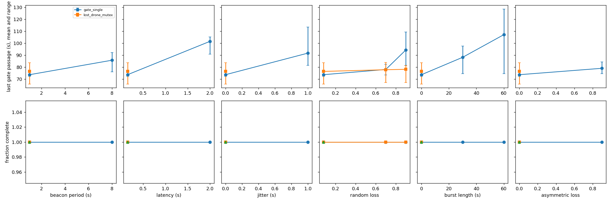
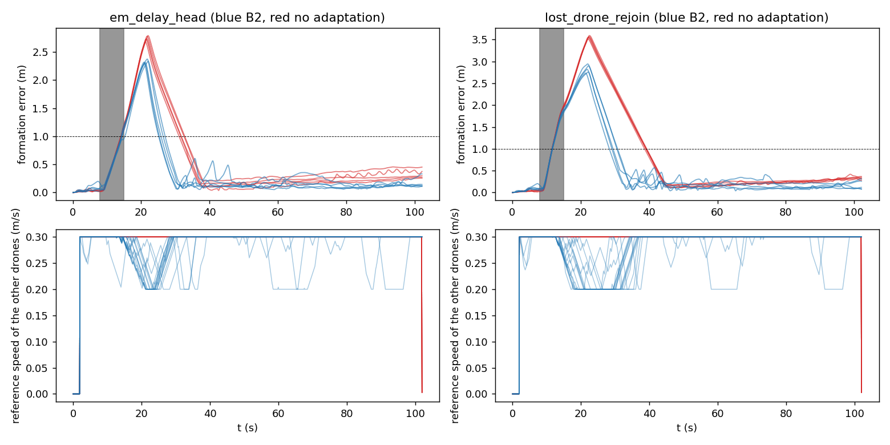

# Decentralised gate passage and formation recovery of a BlueROV2 fleet with local hybrid automata and a one-way acoustic beacon

Technical report of the final version (tag `b2-freeze-v11`, commit 945fc74; campaign of 2026-11-13/14). The analysis tables are in `results/final/FINAL_CAMPAIGN_ANALYSIS.md`, the per-run table in `results/final/runs.csv`, the claims and their premises in `docs/GUARANTEES.md`, the formation contract in `docs/P3_CONTRACT.md`, the acceptance criteria in `docs/ACCEPTANCE_CRITERIA.md` (v8).

## 1. Problem and scope

A fleet of n BlueROV2 vehicles surveys in formation, crosses a 2 m gate one vehicle at a time and re-forms beyond it. There is no leader and no request, reply or command between vehicles. Each vehicle runs the same local hybrid automaton (10 modes) on its own six single-beam sonars, DVL, IMU, compass and depth sensor, and on a mission plan shared before the dive. Architecture B2 adds a one-way TDMA acoustic beacon: every vehicle broadcasts a 64-bit packet (position, error bound, gate index and passage phase, CRC-16) and every receiver measures range and bearing itself. The beacon never enters separation, collision avoidance or the gate precedence; it supports the gate occupancy latch, the vacancy of a lost vehicle and the association of neighbours.

Properties:

- **P1**, separation: every pair of live vehicles stays at least 1 m apart.
- **P2**, mutual exclusion: at most one vehicle centre in the critical region (CR) of the gate.
- **P3**, the formation contract (`docs/P3_CONTRACT.md`): P3a individual slot recovery after the crossing, P3b fleet formation after the last crossing, P3c the degraded formation after an admissible permanent failure; error at most 1 m held 8.9 s, within deadlines derived from the error at the start of the window and the slowest closing speed of the protocol (0.10 m/s), extended by the preemptions of P1 and the declared disturbances.

Failure model: a permanent failure stops propulsion, electronics and beacon together, and the positively buoyant hull rises (0.045 m/s or more). Failures inside the exclusion zone of a gate, from which the passive hull can reach the CR or the frame before it has risen above them (`holo_fleet/scope.py`), are outside the scope: they are not run. The zone, rule D (a silent vehicle is declared dead for the gate only if it was last known outside the zone) and the P3 contract were decided during development, after the runs that motivated them (2026-11-12 and 2026-11-13); only the final campaign was pre-registered.

Simulation: HoloOcean 2.3 with a sonar octree patch (`docs/HOLOOCEAN_OCTREE_PATCH.md`); sensor and channel profiles CLEAN, LOW and MEDIUM are the validation levels (`holo_fleet/sim/sensor_noise.py`, `holo_fleet/sim/acoustic_channel.py`, provenance in `docs/PARAMETER_PROVENANCE.md`).

## 2. Formal verification

`formal/check_properties.py`, z3 5.1.0, at the frozen commit: 284 checks, every one with its expected verdict. After the freeze the fleet suite gained 16 checks without changing the controller (section 6.2: the stage-2 claim guard in the model, the delayed claims F1c and F1d, the entries that bypass stage 2 F0p, F2p, F1p, F0q, F1pa); the suite now has 300 checks, all as expected (`formal/results/SUMMARY.md`).

| Suite | Checks | What it establishes |
| --- | --- | --- |
| Local determinism and priority | 104 | at most one enabled edge and some enabled edge per mode; fault, collision and warning preempt; commit only with priority and a free CR |
| Observation consistency | 32 | the perception never produces an observation outside the domain of the guards |
| P1 separation | 15 | guaranteed opening of the escape and warning filter for every threat pattern of one or two threats |
| P2 mutual exclusion | 45 | precedence (no double priority, the leftmost queued vehicle leads, abreast n = 2..6 and stacks); queue geometry; bounded model checking of the occupancy latch (42 s) |
| P3 formation | 24 | ranking functions of the slot loop (along 0.014 m/s, across 0.25 m/s in the saturated band; invariant balls 0.44 and 0.36 m); bounded waiting and vacancy |
| B2 beacon | 13 | the beacon assumptions; isolation from the safety chain |
| Payload, silence, passage | 32 | claims hold the gate; silence shorter than 70 s excludes nobody; rule D on real receptions (S4) and its mutations (S4m, S4b: the round 8 code); the exclusion zone (S12, nonlinear reals, with coast, rise lag and drift; mutations S12m, S12l) |
| Interacting automata at the gate | 19 | the composition of n = 2, 3, 4 automata: an inductive invariant (at most one vehicle in the stage-2 hold or the CR) gives P2 with no time bound; from any invariant state the fleet re-forms within 26, 40, 52 steps of 5 s once failures and stops end; declared limits checked as satisfiable |

Every proof is on an abstraction. P2 under B2 rests on premise V (the channel never silences a live vehicle for 70 s at a working receiver), premise C (a queued vehicle learns of a commitment before it commits itself, and two vehicles that commit together learn of each other's claim before either is admitted; restated and monitored after the freeze, section 6.2), the H6 navigation bound and the gate-frame navigation premise (1 m). The fleet recovery rests on premise H (a dead hull stops counting as a queued vehicle once it has risen), on a fairness window of 35 s, and on at most n - 2 failures (n = 2: none while committed). The ranking certificate guarantees eventual recovery; the P3 deadlines ask for the nominal closing speed and are not themselves proved.

## 3. Final campaign

Pre-registered matrix (`scripts/final_campaign.py`), 448 runs on seeds 5000-5404, all executed at 945fc74, four HoloOcean instances at below-normal priority:

- A, standard set: 17 scenarios (separation, formation under currents and gusts, gate passage, lost vehicles) x CLEAN, LOW, MEDIUM; 66 runs per profile;
- B, the lost-vehicle family under MEDIUM: 60 runs (a vehicle fails 15 m before the gate);
- C, stress batch under MEDIUM: 26 scenarios x 5 seeds (head, following, cross, oblique currents to 0.30 m/s; sinusoidal and random time-varying water; two vehicles in column, line abreast and stacked queues under cross current; failures away from the gate; separation under current; boundary probes beyond the steady envelope; three probes of declared limits);
- D, beacon ablation: B0 (no beacon) and B2NP (beacon without payload) on 5 gate scenarios x 3 seeds;
- E, sensitivity beyond the validation profiles: compass bias 3 and 4 deg, long-tail channel MEDIUM_HT; 30 runs.

The engine noise is not seeded, so a seed does not reproduce a run exactly; the evaluation is statistical.

### 3.1 Acceptance (criteria v8)

| Item | Criterion | Result |
| --- | --- | --- |
| 1 | formal suite as expected | 284 of 284 |
| 2 | no safety failure, 448 runs | 0 (P1 0, P2 0, unsafe actions 0, SUT errors 0, replay mismatches 0); 95 % upper bound of the per-run rate 0.67 %; smallest true separation 2.40 m |
| 3 | INVALID | 0 |
| 4 | premise V in the validation profiles | 0 live vehicles declared dead |
| 5 | A, complete runs | CLEAN 66 of 66, LOW 66 of 66, MEDIUM 66 of 66 (2 P3_LATE) |
| 6 | B, at least 58 of 60 | 58 of 60 (95 % upper bound of the failure rate 10.1 %) |
| 7 | C, inside the envelope at least 81 of 90; P1, P2 everywhere | 90 of 90; 0 of 130 with a safety violation |
| 8, 9, 10 | reported | below |

Every pre-registered item is met.

### 3.2 Stress, boundary and declared limits

Inside the envelope every one of the 18 scenarios completed 5 of 5, two runs of `st_lost_right_tail` late (P3_LATE). Beyond the steady envelope at the passage speed: cross 0.50 m/s, following 0.50 m/s and gusts to 0.42 m/s completed 5 of 5; oblique 0.40 m/s 3 P3_LATE and 2 PREMISE_VIOLATED; head 0.40 m/s 5 PREMISE_VIOLATED (the current premise W measured: the mission velocity is not control-feasible). P1 and P2 held in all of them.

Declared-limit probes (predicted INCOMPLETE, judged on P1 and P2): a failure on reaching the queue (0 of 5 complete) and while committed (0 of 5): the hull floats at the surface above the queue in still water and the sonar-only precedence yields to it; a failure 3.3 m past the frame (2 of 5 complete): the onboard margin of rule D places the last fix inside the zone and the gate stays closed. P1 and P2 held.

### 3.3 Beacon ablation

| Scenario | B0, no beacon | B2NP, beacon without payload | B2 |
| --- | --- | --- | --- |
| gate_single | 3 of 3 | 0 of 3 | 6 of 6 |
| integrated_short | 3 of 3 | 1 of 3 | 6 of 6 |
| mutex_deadlock_resolution | 3 of 3 | 0 of 3 | 6 of 6 |
| line_parallel_mutex | 3 of 3 | 2 of 3 | 6 of 6 |
| lost_drone_mutex | 0 of 3 (P3_FAILURE: false vacancies) | 3 of 3 | 6 of 6 |

All safe. Without a beacon the gate logic works on the sonar alone, but a lost vehicle is vacated by a deviation heuristic that also vacates a live one (P3c not met). The beacon without its payload is worse than none at the gate: a vehicle heard without a reported phase stays a possible occupant, the latch remains busy and the passage stalls. The gate rules of B2 need the payload.

### 3.4 Sensitivity

Compass bias 3 deg: `gate_single` 5 of 5, `lost_drone_mutex` 4 of 5 (one PREMISE_VIOLATED, gate-frame navigation beyond 1 m). 4 deg: 5 of 5 and 2 of 5 (one INCOMPLETE, two PREMISE_VIOLATED). Long-tail channel: 5 of 5 and 5 of 5; premise V broken there (a live sender silent for up to 549 s at a working receiver), with no live vehicle declared dead and no safety failure. The open localization class grows with the compass bias.

### 3.5 P3 and monitors

P3a: 724 MET, 5 LATE, 17 PREMISE_VIOLATED, 2 NOT_MET, 68 not applicable; P3b: 374 MET, 2 LATE, 2 NOT_MET, 33 not applicable; P3c: 145 MET, 3 NOT_MET (all B0). Slack of P3b to its deadline in the met windows: minimum 2.5 s, median 19.7 s. One wrong validated map fit (a boundary probe at 0.50 m/s cross current); the gate-frame navigation premise exceeded in 7 runs; the H6 bound never exceeded. The fairness window of 35 s was exceeded only in the six-vehicle formations (no gate) and under MEDIUM_HT; in the gate scenarios of the validation profiles the longest all-fresh gap was 16.3 s.

### 3.6 Every failure, by class

- Localization at the gate (the open class): `lost_drone_mutex` s5102 and `lost_drone_mutex_rise_high` s5108 (B), `MEDIUM_HB4` `lost_drone_mutex` s5400: a lateral error of 0.5-1 m at the hold point with an ambiguous map fit; holds without a validated localization. Safe.
- Floating hull above the queue: the 10 runs of the two probes.
- Safe stop of rule D within the onboard margin: 3 runs of `st_lost_after_exit`.
- Beacon without payload: 9 runs of B2NP.
- No beacon, false vacancy: 3 runs of B0.
- PREMISE_VIOLATED beyond the envelope or in sensitivity: 10 runs (current W at 0.40 m/s; gate-frame navigation under compass bias).
- P3_LATE: 7 runs (`formation_gust` 2, `st_lost_right_tail` 2, `st_bd_oblique_040` 3).
No new mechanism appeared.

## 4. Guarantees and limits

Formal, on the abstractions and under their premises: local determinism and priority; the separation filter; the precedence and the occupancy latch; the inductive P2 invariant of the composition; the exclusion zone; the bounded recovery of the composition; the ranking functions of the slot loop. Empirical: P1 and P2 in 448 of 448 runs including stress, boundary and sensitivity; the completion rates of section 3.

Declared limits of liveness (safety held in every case observed):
1. a failure at or near the queue in still water: the floating hull blocks the sonar-only precedence (premise H);
2. the localization at the gate: lateral error and an ambiguous map fit, sensitive to the compass bias;
3. two vehicles, or the last survivor, after a failure while committed: a receiver that hears nobody declares no one dead;
4. a failure outside the exclusion zone but within the onboard margin of rule D ends in a safe stop.

Limit of the P2 proof (section 6.2): an entry into the CR that bypasses the stage-2 check, a held vehicle moved by the separation filter or the escape, keeps the invariant when claims are learnt in time. Two such entries at once after a concurrent commitment, or a queued vehicle moved into the CR, are not excluded by the model. Runtime: 2 of 1057 entries in 612 runs were of this kind, with no other vehicle inside.

Operating envelope: horizontal current to 0.30 m/s at the passage (validated), up to 0.50 m/s across or following beyond the steady envelope with P1 and P2 held; MEDIUM sensors and channel; formations of 2 to 6 vehicles; gate passages run with 2 and 3 vehicles (abreast, column, a stacked pair), the queue geometry proved for abreast queues up to 3 and stacked 2 x 2; permanent failures outside the exclusion zone, at most n - 2 for n >= 3.

Threats to validity: simulation only (HoloOcean sonar and the acoustic channel are models; the coast bound of 1 m and the rise speed are measured in the simulator, not on a vehicle); a single gate geometry; the declared current equals the true bound of each scenario (an operator declaration in the field); the scope, rule D and the P3 contract were set during development; the engine noise is unseeded.

## 5. Development record and reproducibility

Development is recorded in `analysis/MEDIUM_CAMPAIGN_LOG.md` (every batch, with its expectations written before it ran), the design note `analysis/2026-11-09_MEDIUM_ROBUSTNESS_DESIGN.md`, nine rounds of two independent reviews (formal verification; underwater robotics) in `analysis/review_round*_*.md` with their resolutions in `analysis/REVIEW_ROUND*_RESOLUTION.md`. The round 9 reviewers found that rule D read a pruned fix list (fixed and covered by S4b) and approved the freeze at re-check.

Reproduce: `python formal/check_properties.py`; `python scripts/run_tests.py <out dir>` (unit and formal suites); `python scripts/final_campaign.py <list>` and the lanes `scripts/final_campaign_lane.sh` (one HoloOcean instance per lane); `python scripts/analyze_final_campaign.py results/robustness/raw_v11_final`. Post-freeze validation: `python scripts/analyze_validation.py <out> <raw>`, `python scripts/audit_commitment_visibility.py <raw> <out.json>`, `python scripts/audit_cr_entries.py <out.json> <raw...>`; its 164 raw runs stay in `results/validation/pilot` and `results/validation/heldout` (not versioned; code commit, seed and engine build in each `run_metrics.json`). The raw runs of the final campaign stay on disk in `results/robustness/raw_v11_final` (not versioned); the historical development runs are archived outside the repository.

## 6. Post-freeze validation (2026-11-16)

Three studies requested after the freeze, run on the v11 controller unchanged; details in `analysis/VALIDATION_REPORT.md`.
- Additions on branch `lorenzo-validations`: a parametric acoustic channel, the no-adaptation baseline B2NA (`neighbour_adaptation`, default on, same code path), referee monitors and the scenario `em_delay_head`.
- Runs: 164, all completed. The pilot has 64 runs (seed 6000, commit 58060df). The held-out set has 100 runs (seeds 6100-6104, commit 4d45dd0), chosen by a rule committed before the pilot was read (`analysis/VALIDATION_LOG.md`, `results/validation/report/heldout_selection.txt`).
- Safety: P1 and P2 held in all 164 runs (smallest separation 2.86 m).

### 6.1 Communication robustness
One factor of the LOW channel at a time, gate_single and lost_drone_mutex, 5 held-out seeds per configuration.
- **Finite degradation** (beacon period 8 s, latency 2 s, jitter 1 s, random loss 0.7 and 0.9, bursts of 30 s, asymmetric loss 0.9): every run complete, with no P3 failure. The mean gate wait rose from 29.9 s to at most 44.3 s and the last passage from 73.7 s to at most 101.5 s.
- **Bursts of 60 s every 90 s:** 3 PASS and 2 P3_LATE.
- **Pilot P3c failure:** one run of the pilot (loss 0.9, lost_drone_mutex) failed P3c. A live vehicle was declared vacant after a silence longer than the fairness premise allows (49.1 s against 35 s). The 5 held-out seeds of that configuration passed.
- **Blackout:** lost_drone_mutex ended PREMISE_VIOLATED in 5 of 5 runs, because the vacancy is declared at 129-131 s, beyond its 48 s deadline.

In this sweep, delay, jitter, period, bursts and asymmetry lengthened the waits. P3 was affected only by losses long enough to break the silence premises. Interactions between factors were not tested.

### 6.2 Premise C, the composition model and an entry that bypasses stage 2
**Episodes.** The 448 final runs contain 1007 episodes: commit edges, counted per other vehicle queued and not committed. The figure of 688 counts only B2_CLEAN, B2_LOW, B2_MEDIUM and B0; the other 319 are B2NP 296 and B2_MEDIUM_HT 23. Every episode was learnt within 14.4 s (B0, sonar only), and within 7.3 s under B2.

**The fleet model.** The model lost P2 with a latch one step late because its stage-2 entry ignored the claims, which the code checks (`entry_ok`, S1). With that guard:
- P2 holds with claims learnt up to 2 steps (10 s) late under the sonar precedence and up to 1 step (5 s) without it (F1d, n = 3, bounded), tight at the next step;
- F0 and F2 are unchanged.

The 32 s of S2 bounds the age of a report of not engaged, not this delay.

**The concurrent commitment of `st_lost_middle` s5201.** Two vehicles committed 0.5 s apart, out of sonar range of each other. Each learnt of the other's claim in 0.3 and 0.6 s and held. The CR never held more than one vehicle. The held vehicle ahead, pushed forward by the separation filter and the escape away from the other, entered the CR without admission. While inside, it kept its claim (`report_phase`, S9), and the other vehicle was admitted only after it had passed.

**Formal resolution** (`formal/check_fleet.py`):
- **F0p, F2p:** an entry that bypasses the stage-2 check, by a committed vehicle at any step, keeps the inductive invariant and the bounded recovery for n = 2, 3, 4.
- **F1p:** after a concurrent commitment, two such entries at once give two vehicles in the CR in the model.
- **F0q:** so does a queued vehicle moved into the CR.
- **F1pa:** the deployed escape planner is not antisymmetric along the gate axis. Two vehicles at their hold points that see each other can both be moved forward (8 mirrored patterns), so no lemma excludes the double entry. F1p and F0q are therefore declared limits.

**Runtime audit** (`scripts/audit_cr_entries.py`, 612 runs): 1057 entries. 1055 were admitted, 2 were pushed (both in s5201) and none were uncommitted; at none of them was another vehicle inside the CR. No safety defect was demonstrated, so the controller was not changed. A CR-aware constraint on the escape of a held vehicle would close the gap; it is not part of v11.

### 6.3 Emergent coordination
One vehicle of a square of four was pushed back by a jet (8-15 s). B2 was compared with B2NA: the same plan, without the neighbours' adaptation. 5 seeds each, all PASS.
- **B2 neighbours:** about 4.7 s after the jet starts they lower their reference speed from 0.30 to 0.20 m/s and yield 2.5 m (head jet) and 4.6 m (head and cross jet) of progress.
- **B2NA neighbours:** they do not react.
- **Effect of the adaptation:** the peak formation error is lower by 0.41 and 0.72 m (2.33 against 2.74 m, 2.83 against 3.55 m) and the recovery after the jet is shorter by 6.0 and 9.4 s. The seed ranges do not overlap on any of these measures.

The response is local: each neighbour uses its own fixes of the delayed vehicle.

Limitations of the validation: one factor at a time, 5 seeds per held-out configuration, and the levels chosen by the rule. The rule's duration criterion was insensitive because the scenario end time is fixed by the plan. Fairness is logged, not used in the classification. The fleet model works in steps of 5 s.
