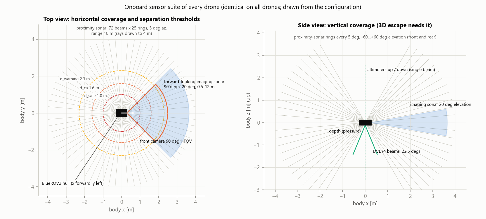
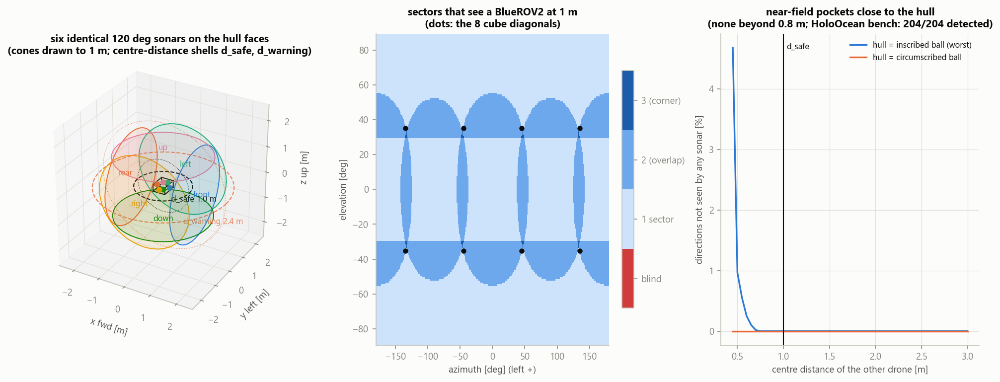
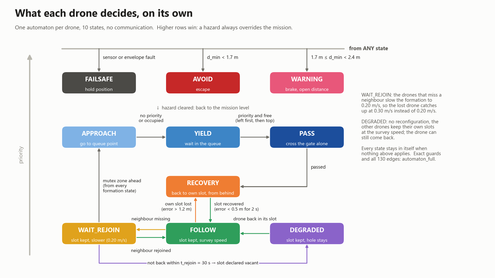

# Validation report

This report covers the final validated implementation:

- the architecture and the operating domain;
- the requirements and the acceptance criteria;
- the paired campaign `v46` and the supplementary LOW/HIGH runs `v47`;
- the run audit;
- the Z3 catalogue and the scope of its guarantees;
- the premises and the remaining limitations;
- the reproduction steps.

Every guarantee is conditional on the operating domain in section 2 and on the HoloOcean 2.3.0 models (Romrell et al., 2025; `references.bib`,
`Romrell2025holoocean2`). No result covers field
hardware.

## 1. Architecture

### 1.1 Controller and sensors

One local hybrid automaton runs on every vehicle (`holo_fleet/ha/spec.py`). There is no leader and no request, reply or
command between vehicles.

- **B2** is the controller: the automaton plus passive one-way acoustic beacons between vehicles.
- **B0** is the same controller with `config.communication_disabled` set (`tests/test_single_controller.py`). It is a
  baseline only.

Both protocols receive the gate beacon. Controllers never read ground truth (`tests/test_isolation.py`). The parameters are in
`FleetConfig` (`holo_fleet/config.py`), and their sources are in `config/parameter_sources.json`.

| Stream | Configuration and error model |
|---|---|
| Six single-beam sonars | 10 Hz, 0.05 m bins. The range residual of a valid return is in [-0.08, +0.12] m. Relative tilt is at most 10 deg. The side sonars are blind below 0.30 m. |
| DVL | 10 Hz, bottom-locked ground velocity. The budget has a 1% scale error, a 0.0285 m/s noise scale and an outage term. |
| IMU | 30 Hz. CLEAN noise scales are 0.01 m/s² and 0.005 rad/s. |
| Compass | 30 Hz, CLEAN noise scale 0.005. Heading error and bias enter the navigation and acoustic budgets. |
| Pressure depth | 30 Hz, CLEAN noise scale 0.02 m, with a 0.45 m depth allowance. |
| B2 acoustic beacon | TDMA period 1 s. Latency at most 0.40 s, clock skew at most 0.05 s. A fix is fresh for 2.5 s. |
| Gate beacon | 2 Hz. Range sigma 0.10 m, angle sigma 1 deg, 5% dropout, range at most 30 m. Heading bias at most 2 deg. |

The maximum onboard ages are:

- 0.25 s for sonar and IMU;
- 0.20 s for compass and depth;
- 0.35 s for DVL health, with 0.15 s for the velocity loop.

Missing or invalid data never refresh a measurement.





### 1.2 Automaton and gate protocol



The automaton has ten modes. Their edges are in priority order:

1. failsafe;
2. collision avoidance (`d_min` < 1.7 m, exit at 2.0 m);
3. separation warning (`d_min` < 2.4 m, exit at 2.7 m);
4. `MUTEX_APPROACH`, `MUTEX_YIELD`, `MUTEX_PASS`;
5. formation recovery;
6. formation keeping.

`d_min` is a sonar-only lower bound on the pair distance. All guards are evaluated at runtime as a determinism monitor.

The gate geometry at G06 is:

- the CR is `-0.8 <= s <= 0.0 m`, `|l| <= 1.0 m`, `|z| <= 1.0 m`;
- the passage is reserved through `s = +0.55 m`;
- the stage-2 hold is at `s = -2.5525 m`;
- the admission zone spans -0.4 / +0.3 m along the axis from the hold, `|l| <= 0.35 m` and `|dz| <= 0.9 m`.

The protocol has five steps:

1. **Precedence.** Precedence comes from the sonar sector pattern only. The leftmost queued vehicle wins after `t_clear` =
   1.0 s.
2. **Occupancy latch.**
   - BUSY is set by an unexplained FRONT echo in the CR range or, with B2, by a claim.
   - EXITING is set by an exit witness.
   - FREE follows only from EXITING, after `t_clear`.
   - A BUSY with no corridor echo, nothing heard and nothing known inside becomes STALE after `t_occ_max` = 25 s. STALE allows
     commitment but is never FREE.
3. **Commit.** The vehicle commits when it is calm, at its queue point, has priority and the latch is free.
4. **Admission.** The vehicle is admitted when all of these hold:
   - it is in `MUTEX_PASS` with healthy sensors and a validated localization;
   - the stage-2 check passes for 3 captures;
   - its estimate is in the zone;
   - the near-field clearance holds: no hull bound below `admit_clear_m` = 3.3 m in any sector;
   - the admission wait has passed.

   The B2 wait is 4.0 s when every other vehicle was heard within 3.5 s. Otherwise it is 41.52 s, that is 4.0 s plus
   `t_cross_max` = 37.52 s. B0 waits 0 s. An admission without a positive exit witness happens strictly after max(last
   corridor sighting, dwell start) + 37.53 s.
5. **Give-up.** If there is no admission 26 s after the wait and the timed bound end, the vehicle retreats and queues again.

A vehicle that is not heard is unknown, and a claim stands until its sender withdraws it. Silence never excludes an occupant.

The other components are:

- **P2 filter** (`holo_fleet/control/gate_safety.py`). It applies a command near the gate only if a backup cannot bring the
  true centre into the CR column. The backup is the command for 0.35 s, braking at 0.5 m/s², then a hold within 0.30 m with
  0.15 m/s drift. The true position is within `nav_err_m` of the estimate. With no certified command the controller logs
  `P2_UNCERTIFIED` and retreats.
- **B2 beacon** (`holo_fleet/perception/payload.py`). It sends a 64-bit packet with position, error bound, gate index and
  phase, protected by a CRC. The receiver measures range and bearing itself and attaches the packet only if the two agree.
  The data enter perception only: claims, exit evidence, the admission wait, formation association, and vacancy after 45 s
  of silence. They never enter `d_min`, precedence or escape (`tests/test_b2_isolation.py`).
- **Gate beacon and classification.** An echo is STRUCTURE only if its range is in the map window seen from a corrected pose.
  That pose is the median beacon fix with bound at most 0.45 m, or else an accepted structure fit. The window is widened by
  the pose bound. The beacon corrects the estimate fully before admission and only laterally after it.

## 2. Requirements and operating domain

- **P1, separation:** every pair stays at centre distance strictly above `d_safe` = 1.0 m.
- **P2, mutual exclusion:** at most one vehicle is in the CR of a gate, and only after admission.
- **P3, eventual formation recovery:** after a temporary disturbance, the healthy communicating fleet eventually re-enters the
  declared formation tolerance. Permanent failures and indefinite silence have degraded behaviour with no recovery guarantee.

The operating domain is declared in `holo_fleet/config.py`, `holo_fleet/sim/sensor_noise.py` and `holo_fleet/scope.py`. No
property is claimed outside it.

- **Fleet.** 2 to 4 vehicles at one gate: abreast queues of 2 or 3, stacked 2 x 2, or a 3-vehicle stack pair. Abreast 4 or
  more is refused.
- **Currents.** Horizontal current within the feasible envelope, validated to 0.6 m/s. Vertical current at most 0.25 m/s.
- **Drift.** Unrejected drift at most 0.15 m/s per axis. Residual disturbance at most 0.05 m/s for P3, whose proof margin
  vanishes at 0.064 m/s.
- **Navigation and motion.** `nav_err_m` = 1.0 m per gate-frame axis. Depth from -9.0 to -1.5 m. Braking at least 0.5 m/s².
  Speed at most 0.5 m/s.
- **Failures.** Permanent failures only outside the gate exclusion zone, never in the CR. One failure for 2 vehicles, never
  while committed. At most n - 2 failures for n >= 3.
- **Profiles.** CLEAN; LOW and MEDIUM at nominal datasheet levels; HIGH as stress. The acoustic channels are in
  `holo_fleet/sim/acoustic_channel.py`. MEDIUM noise is unbounded, so the formal domain needs the declared range-error, tilt,
  capture and actuator premises at use.

## 3. Protocol and acceptance criteria

### 3.1 Campaign v46

The matrix `config/publication_validation.json` has 9 cases x seeds 0, 1, 2 x protocols B0 and B2, which makes 54 runs. Every
run goes to the mission terminal.

| Case | Scenario | Sensing | B2 channel | Injection |
|---|---|---|---|---|
| encounter | `p1_two_lines` | CLEAN | CLEAN | - |
| sonar-blackout | `p1_two_lines` | ISO_sonar_blackout | CLEAN | - |
| formation | `formation_recovery_head_current` | CLEAN | CLEAN | - |
| gate | `line_parallel_mutex` | CLEAN | CLEAN | - |
| gate-acoustic-medium | `line_parallel_mutex` | CLEAN | MEDIUM | - |
| simultaneous-clean | `line_parallel_mutex` | CLEAN | CLEAN | two concurrent commitments |
| simultaneous-medium | `line_parallel_mutex` | MEDIUM-ALL | MEDIUM | two concurrent commitments |
| dvl-interruption | `line_parallel_mutex` | ISO_dvl_dropout | CLEAN | - |
| integrated | `integrated_short` | MEDIUM-ALL | MEDIUM | - |

Four engines ran at once, each with its own patched root, port and client. Their isolation was proven first with
`scripts/verify_engine_isolation.py`.

All runs were recorded at `7d8662f6e19e8e7d0cc010963507dfd12b681f2d` with a clean tree. Its runtime code is that of
`a8572d241362955a6f68cbe1bc61353de1d2c512`. All 27 pairs have identical configuration and runtime code. The matrix SHA-256 is
`3cd2a14b6d2415cda0613ae9f0467a2facbad084f5a6da1f1d6c12b4bc82907f`. Per-run raw-file hashes are in
`results/final_paired_validation.json`.

### 3.2 Acceptance criteria v9

A run ends with one of three outcomes (`holo_fleet/referee/terminal.py`, `holo_fleet/referee/criteria.py`):

- **FAILURE:** a P1 pair below `d_safe`, two vehicles in a CR, or a contact.
- **SUCCESS:** every requirement holds at once, no earlier than the nominal end:
  - every healthy vehicle is near its planned end;
  - every healthy vehicle passed the judged gate through the CR;
  - the formation has no open loss episode;
  - a lost slot was declared vacant;
  - there is no false vacancy;
  - no vehicle is still waiting for a neighbour.
- **DEADLINE:** neither by the nominal end plus the worst-case protocol delays.

P3 is *eventual* recovery within the run horizon. The bounded recovery times are reported, not judged.

### 3.3 Run audit

`scripts/audit_final_campaign.py --expect N` re-derives every run from its raw logs with the final referee. A run is accepted
only if all of these checks pass:

- `analysed`, `monitors_present`, `class_pass`, `class_reproduced`, `terminal_success`;
- `one_judged_gate_at_most`, `gate_metrics`, `all_crossed`, `formation_recovered`;
- `p1`, `p2`, `no_unsafe_admission`, `no_false_release`;
- `premise_nav_bound`, `premise_gate_nav`, `premise_v`, `premise_c`, `scope`;
- `premise_zone_nav`, `premise_beacon_fix`, `premise_queue_cls`, `queue_cls_observed`;
- `plans_reproduced`.

The audit fails closed. Any of the following rejects a run or the whole campaign:

- a missing monitor;
- an unanalysable run (INVALID, SUT_ERROR);
- a gate scenario without gate metrics or without any judged queued sample;
- more than one judged gate;
- an empty campaign, or a run count different from `--expect`.

`plans_reproduced` requires each run's recorded queue plans to equal the ones the scenario code rebuilds, because Q2 is judged
against them. They are equal in all runs of `v46` and `v47`. Wrong validated fits and the classification sources outside the
queue are reported, not judged.

### 3.4 Premise monitors

The referee monitors each premise on every sample as a cause tag. The audit judges it per run.

| Monitor | Premise |
|---|---|
| `nav_bound`, `gate_nav` | navigation error within its onboard bound, and within `nav_err_m` while committed |
| `zone_nav` (Z) | an estimate in the admission zone is within 0.65 m horizontally and 0.25 m vertically of the truth |
| `beacon_fix` (B) | the true position is within `cls_bound` of the classification pose in use |
| `queue_cls` (Q) | **Q1:** a queued vehicle classifies at its navigation estimate, within 1.0 m per axis. **Q2:** the FRONT sonar of an off-axis queued vehicle is at most 0.7 m outward of its queue point, with a 0.025 m lever added to the logged body position. A sample at a beacon or fit pose, or one without a plan, fails Q. |
| `premise_v`, `premise_c`, `scope` | declared velocity, clock and scope premises |

## 4. Results

### 4.1 v46 paired campaign

The sources are `results/final_paired_validation.json` and `results/final_run_audit.json` (53 of 54 accepted).

- **B2: 27 of 27 PASS and accepted.** Every run ended in mission SUCCESS. Every vehicle crossed in all 18 gate runs.
- **B0: 26 of 27.** The rejected run is `simultaneous-medium` seed 1: P3_FAILURE (DEADLINE), failing `class_pass`,
  `terminal_success` and `formation_recovered`. All three vehicles crossed, and P1 and P2 held. This is the B0
  formation-association limit (section 6.4).
- **Safety, both protocols:**
  - zero P1 violation samples and zero contacts;
  - smallest centre distance 2.031 m (B0) and 2.633 m (B2);
  - in the 36 gate runs, peak occupancy one, zero premature admissions and zero false releases.
- **`P2_UNCERTIFIED`:** at most 3 events per run, under MEDIUM sensing or DVL interruption. None coincided with a violation.
- **Premise maxima:**

  | Monitor | B2 | B0 |
  |---|---|---|
  | `zone_nav` | 0.40 m horizontal, 0.21 m vertical | 0.40 m horizontal, 0.21 m vertical |
  | `beacon_fix` | 0.29 m | 0.29 m |
  | `queue_cls` per axis | 0.39 m | 0.42 m |
  | `queue_cls` outward | 0.43 m | 0.40 m |

  Every queued sample classified at the navigation estimate. Beacon poses outside the queue (retreats) were counted in four
  B2 runs. There were zero wrong validated fits.

| Case | Gate completion B0, median (range) s | Gate completion B2, median (range) s | B2 P3 recovery, max s |
|---|---|---|---|
| gate | 228.6 (223.9, 234.4) | 87.9 (85.0, 96.9) | 101.0 |
| gate-acoustic-medium | 187.3 (168.5, 212.4) | 91.1 (81.5, 168.8) | 207.1 |
| simultaneous-clean | 323.2 (185.0, 427.6) | 91.8 (91.8, 123.8) | 146.6 |
| simultaneous-medium | 293.7 (188.6, 311.9) | 123.6 (93.7, 166.0) | 204.9 |
| dvl-interruption | 203.0 (193.3, 280.8) | 80.1 (79.6, 84.9) | 84.8 |
| integrated | 211.4 (126.6, 265.3) | 97.3 (89.2, 103.8) | 107.5 |

In `formation` both protocols recovered within 8.2 s. `encounter` and `sonar-blackout` have neither a gate nor a recovery
window. Three seeds are descriptive evidence, not a statistical bound.

### 4.2 v47 LOW and HIGH

These runs are `line_parallel_mutex`, seed 0, from the same tree (`results/low_high_run_audit.json`, 2 of 4 accepted).

| Run | Class | Min. distance | Occupancy | Crossed | Failed checks |
|---|---|---:|---:|---:|---|
| B0, LOW-ALL | PASS | 3.391 m | 1 | 3 | none |
| B2 (LOW), LOW-ALL | PASS | 3.325 m | 1 | 3 | none |
| B0, HIGH-ALL | PREMISE_VIOLATED | 2.603 m | 0 | 0 | gate nav, zone nav, queue cls, completion |
| B2 (MEDIUM_HARSH), HIGH-ALL | INCOMPLETE | 2.688 m | 1 | 1 | zone nav, beacon fix, queue cls, completion |

HIGH is outside the declared premises. No HIGH acoustic channel exists, so B2 HIGH ran on MEDIUM_HARSH, the harshest defined
level. The monitors flag the violations:

- `queue_cls` up to 3.30 m (B0) and 4.11 m (B2);
- `zone_nav` up to 4.23 m (B0);
- `beacon_fix` up to 0.68 m (B2);
- committed navigation error up to 4.23 m (B0).

In all four runs P1 held, occupancy stayed at most one and there were zero unsafe admissions.

### 4.3 Property table

The CLEAN columns include the isolated faults. For B2 they also include `gate-acoustic-medium` on the MEDIUM channel. The
MEDIUM columns are MEDIUM sensing with the B2 MEDIUM channel. The LOW and HIGH columns come from `v47`.

| Property | B0 CLEAN | B0 LOW | B0 MEDIUM | B0 HIGH | B2 CLEAN | B2 LOW | B2 MEDIUM | B2 HIGH | Z3 proof status |
|---|---|---|---|---|---|---|---|---|---|
| Runs accepted by the audit | 21/21 | 1/1 | 5/6 | 0/1 | 21/21 | 1/1 | 6/6 | 0/1 | - |
| Mission SUCCESS (class PASS) | 21/21 | 1/1 | 5/6 | 0/1 | 21/21 | 1/1 | 6/6 | 0/1 | simulation outcome, not a formal property |
| Every vehicle crossed (gate runs) | 12/12 | 1/1 | 6/6 | 0/1 | 12/12 | 1/1 | 6/6 | 0/1 | liveness: M5 argument under fairness, not proved |
| P1: no violation or contact; min. centre distance | 21/21, 2.20 m | 1/1, 3.39 m | 6/6, 2.03 m | 1/1, 2.60 m | 21/21, 2.63 m | 1/1, 3.33 m | 6/6, 2.95 m | 1/1, 2.69 m | proved pairwise (interval certificate, escape); bounded S1a, S1d, S4, S1ga; several neighbours by the triangle lemma; S1gm limit |
| P2: occupancy <= 1, no premature admission or false release (gate runs) | 12/12 | 1/1 | 6/6 | 1/1 | 12/12 | 1/1 | 6/6 | 1/1 | proved M1, M2, ST1, B2C, P2B1, P2R4-5; bounded M3, M3h, M3q, M3hq (n <= 3, premise Q), S2, B2C-S1; numeric M4, P2B3 |
| P3: formation recovered | 21/21 | 1/1 | 5/6 | 0/1 | 21/21 | 1/1 | 6/6 | 0/1 | one vehicle and one pair under A6, A7 (C1, C2), composition rule C5; no fleet-level ranking |
| Declared premises hold (navigation, Z, B, Q, V, C, scope) | 21/21 | 1/1 | 6/6 | 0/1 | 21/21 | 1/1 | 6/6 | 0/1 | declared and monitored per sample; Q bounded at a fixed pose per query (M3q; M3ql limit; a pose change within one crossing not covered), Z declared and monitored (`zone_nav`; ST1 proved under Z, ST6 numeric), B numeric (CL5) |

## 5. Z3 catalogue

`python formal/check_properties.py` runs 13 suites with 475 checks. All 475 gave the expected outcome, with no unexpected
verdict, in about 136 min on the final tree (archive `v51-formal-final-cleanup`). Each check's formula, kind and verdict is in `formal/results/SUMMARY.json` and `SUMMARY.csv`.

| Kind | Count | Meaning |
|---|---:|---|
| proved | 202 | UNSAT of a universal or inductive property (invariant, k-induction, ranking function) |
| bounded | 43 | UNSAT over a bounded horizon (BMC, or bounded response from an invariant) |
| numeric | 59 | enumeration or sampling of a continuous domain or the deployed code; no proof outside the samples |
| limit | 26 | declared limitation: an expected counterexample outside the guarantee, unresolved |
| scope | 13 | expected counterexample marking where an assumption ends |
| mutation | 84 | expected counterexample of a broken variant: the check can fail |
| witness | 32 | expected SAT: non-vacuity, tightness, independence |
| reported | 16 | quantity reported, not guaranteed |

Only `proved` and `bounded` results support a guarantee. Counterexamples of mutations, witnesses, scope checks and limits are
never safety evidence. Each M3q and M3hq entry stands for its sampled queries: 324 samples and 648 BMC queries, all UNSAT.

What the catalogue establishes:

| Area | Proved | Bounded | Numeric |
|---|---|---|---|
| Automaton | determinism, completeness, priority, gate rules, readable guards (D1, D2, H1-H3, G1-G3, L1, O5) | - | - |
| P1 | S5 interval certificate, given a sound nearest-centre bound and valid ground-speed caps; radial `G(d >= d_safe)` by k-induction, k = 13 (S1b); triangle lemma (S3); S1gb | S1a start-up 4 s; S1d deceleration 0.743 m/s²; S4 blackout 0.8 s from 2.34 m; S1ga 6 s | S0 onboard bound sound; S2a-S2d opening speed; J1, 25,272 decisions |
| P2 | timed admission ST1; latch ST2; give-up ST3; DVL outage P2R6, P2R2o; precedence M1, M2; occupancy F0i, F0s, F0p (n = 2, 3, 4); B2 communication B2C-E1, E2, E2k, Ea, Eb, Ee, E3, D; filter P2B1, P2R1-P2R3d, P2R4, P2R5 (selection rule as an axiom) | latch M3, M3h, 42 s; premise Q M3q, M3hq (2 and 3 abreast); freshness S2, S2h, 32 s; late claims F1d1, F1d2 (F1d3 tight); filter entries F1p; B2C-S1, 100 s | M4a-M4g, Q1 geometry; M4dq exposure at least 0.58 s; ST6, 3.246 m; P2B1r; P2B3, 30,300 trajectories; P2B6, 12,780 trajectories; P2R4n, 6,244 commands and 149,856 next states |
| Classification | CL7 chord lemma; CL8a, CL8c displaced sonar; CL8b widening for R in [0.73, 7.05] m at E = 0.5 m and [0.64, 7.07] m at 0.45 m | - | CL1, 864 cases; CL2, CL4, CL6; CL5 Monte Carlo (premise B, statistical) |
| P3 | F1-F3 rankings, balls 0.44 m and 0.36 m; F4a-F4d; C1f, C1n, C1z coupled law; C2a-C2d, C2w clocks; C3e, C3h, C4 rendezvous; F6r, F6g vacancy | F6 vacancy within 30 s; F2, F2p fleet recovery within 26, 40, 52 steps of 5 s for 2, 3, 4 vehicles (F2t tight) | - |

| P3 obligation | Status | Checks |
|---|---|---|
| Slot error of one vehicle decreases | proved: far band B0 and B2; near band under A6 | C1f, C1n, C1z; limits C1l1, C1l2 |
| Formation modes once the slot is recovered | proved | F4a-F4d |
| Pair clocks re-synchronise | proved with a fresh fix each step (A7) | C2a-C2d, C2w; scope C2s; limit C2l |
| Vacancy of a neighbour that never reappears | proved, bounded at 30 s | F6r, F6g, F6 |
| Fleet recovery from the invariant | bounded: 26, 40, 52 steps | F2, F2p, F2t |
| Composition across mode switches | rule proved for a common rank; not discharged for the deployed ranks | C5i, C5p; scope C5s |
| Consensus drift below `s_res` (A6) | premise, not proved | C1l1 |
| Recovery under sustained safety interventions | not covered | C5s |

P3 is therefore eventual recovery for one vehicle and one pair under A6 and A7, plus a bounded fleet result from the
invariant. No fleet-level ranking across gate passages and avoidance is proved. A proof of the complete deployed P1 closed
loop, including indefinite relative hold, is open.

## 6. Premises and remaining limitations

| Property | Unbounded proofs | Bounded checks | Numerical evidence | Declared limits |
|---|---|---|---|---|
| P1 separation | pairwise interval certificate and escape; several neighbours by the triangle lemma and S2c | S1a, S1d, S4, S1ga | J1, Q1 | S1gm; no fleet model of several neighbours; tilt not monitored |
| P2 mutual exclusion | M1, M2 (within `queue_tol`), ST1 under Z, B2C, P2B1, P2R4-5 | M3, M3h; M3q, M3hq (premise Q); S2, S2h; B2C-S1; F1p | M4a-M4g, M4dq; P2B3; F1pk (reported) | crossing vehicle off the axis; M3 masking and WAIT abstraction; M2 under the navigation error; compass error; ST6l; M3ql; queued pose varying within one query; vertical offset at the queue; stacked queues under the navigation error (M2v, M4s exact pose); abreast 4 (M3qs); B0 exit witness for 3 (M4g); mutually unheard pair (B2C-Es); entry by avoidance outside the P2 envelope (F1pe, F1pme, F0qe); F1p mechanism with positions only reconstructed (F1pk) |
| P3 formation recovery | C1, C2 for one vehicle and one pair; rule C5 | F6, F2 | - | A6 a premise (C1l1); C1l2, C2l without a ranking; no fleet-level ranking; B0 not covered |
| Echo classification | CL7, CL8a, CL8c, CL8b | - | CL1-CL6; premise B (CL5) statistical | roll, pitch and the heading-error mount displacement not modelled |

### 6.1 Premise Q and the occupancy latch

M3 and M3h take the queued pose as exact. M3q and M3hq model it as on board:

- the estimate is within `queue_tol` = 0.35 m of the queue point;
- the true position is off by up to 1.0 m per axis and at most 0.7 m outward;
- the crossing vehicle is seen from the true position.

The binding case is a true position far outward with the estimate inward.

- **M3ql (limit).** `at_queue` plus the navigation premise allow 1.35 m outward. At 1.0 m the outer point of 3 vehicles has a
  counterexample, so Q2 bounds the offset at 0.7 m.
- **M3qs (scope).** Abreast 4, which is refused, fails at 1.0 m outward.
- **M3qm (mutation).** Without the band latch input, M3hq fails.

Not covered:

- **Queued pose varying within one query.** Each query fixes one pose for 42 s, while the referee judges each sample alone.
  The closest bad combination needs a 0.3 m move and a 1.0 m drop of the along-axis error during a 0.38 s window, and the
  monitor does not flag it. "Q holds" means every queued sample is within Q.
- **Vertical offset at the queue.** `at_queue` allows 0.35 m in depth, but Q is horizontal and the latch geometry is planar.
- **Steps before the queue point.** Approach and retreat are counted, not judged.
- **Stacked queues under the navigation error.** Only M2v and M4s at the exact pose cover them.
- **Crossing vehicle off the axis.** The side-view exposure can drop to 0.
- **The M3 abstraction.** Masking applies in every sector, and a visible crossing vehicle gives WAIT.
- **M2 under the navigation error.** M2 is verified within `queue_tol` only. A misread relation gives a concurrent commitment
  (met by the latch, the clearance and the give-up) or a stall. Neither case is proved. M2s marks the scope: two drones
  whose adjacent queue points are 10.5 m apart (beyond the 7.5 m queue bracket) do not count each other and both take PRIORITY.
- **The compass error.** It is not modelled. M4e holds only at the exact pose, and M4bq is reported.

### 6.2 Admission clearance (premise Z)

The clearance rests on two premises:

- the P1 detection premise: a vehicle within 3.3 m echoes in a healthy, unmasked sector;
- premise Z.

With only the committed navigation premise, two vehicles in the zone can be 4.68 m apart (ST6l). A sector blind within 3.3 m,
such as a shallow seabed under the DOWN sonar, withholds the clearance. None was observed at G06.

The admission is latched. A vehicle that avoidance pushes back re-enters the CR without a new check, which is outside premise
Pi2. ST7 is a progress margin, not a proof of progress. Concurrent commitments resolve by the give-up, not by a ranking.

### 6.3 Echo classification near the frame (premise B)

- **Bar echo at the CR entry.** Without a beacon fix or an accepted fit, the window is computed at the estimate, and a bar can
  be taken for an obstacle at the CR entry (CL1m: a 0.72 m lateral error, within `nav_err_m`). This costs progress; P1 and P2
  hold.
- **CL2r masking.** Widening masks up to 1.40 m beyond the unwidened window. Near the frame, P1 rests on the detection premise
  with the widened window.
- **Side bars.** The side sonars are blind below 0.30 m. The 0.70 m keepout tolerates a 0.41 m lateral error, against a
  beacon bound of 0.40 m (CL6). The margin is thin.
- **Beacon premise.** Errors are within 3 sigma, the heading bias at most 2 deg, and the pinger at its surveyed position. This
  is monitored as `beacon_fix`, and the median bound is statistical (CL5).
- **Navigation bound.** Each beacon correction adds its size to the dead-reckoning bound, which is also the B2 packet bound.
  This is conservative, at a cost in precision.

### 6.4 B0 formation association

B0 associates echoes with slots by range alone. Opposite compass biases can push the relative drift beyond the 1.2 m range
gate (up to 2 `nav_err_m`). A live neighbour is then declared vacant after `t_rejoin`, and its echo is associated with the
neighbour it occludes. The lateral correction then settles at a wrong equilibrium.

This is the rejected `v46` run (`simultaneous-medium` seed 1). P1 and P2 held. B2 resolves the ambiguity with the acoustic fix.
M4g: for 3 vehicles a B0 queued vehicle may get no sonar exit witness, so the latch releases only through STALE.

### 6.5 Communication and failures

- **Mutually unheard pair.** After 41 or more consecutive losses both ways (B2C-Es), P2 rests on the B0 mechanisms (B2C-EL,
  B2C-S1b). The stage-2 sonar is not certified (B2C-G1). B2C-S2 lists four ways the bounded admission can stall.
- **Permanent failure.** A dead vehicle is never accounted for, so survivors can stall safely:
  - F2c: a vehicle that fails while committed keeps its claim;
  - F2d: a failure outside the commitment;
  - F2s2, F2s3: two vehicles, and the last survivor of three;
  - F2s4: a hull floating above the queue.

  F2 does not model the degraded wait.
- **False vacancy.** A live vehicle with a mute transmitter is declared vacant after 45 s.
- **Liveness cost.** A vehicle that is not heard fresh triggers the 41.52 s wait. Without a validated localization no vehicle
  is admitted.

### 6.6 P2 filter envelope and the F1p mechanism

- **P2R4l.** An outage that begins, or a position correction, after a certificate is handed can leave no certified action.
  P2R4 takes the selection rule as an axiom, checked numerically (J1, P2R4n).
- **F1p is open with positions.** F1p (bounded, `formal/check_fleet.py`) excludes two vehicles in the CR under late claims and
  concurrent commitments only through the P2 filter (P2B1, P2B3). Outside the filter envelope the fleet model has
  counterexamples:
  - F1pe: navigation error, drift or an estimate jump;
  - F1pme: the same with the motion limit of an avoidance entry;
  - F0qe: a queued, uncommitted vehicle.

  In each, a vehicle moved into the CR by avoidance can join an occupant. The fleet model has no positions.
- **F1pk** (`formal/check_f1p_kinematic.py`, `formal/results/f1p_kinematic.json`) reconstructs the mechanism with moving
  vehicles and the deployed decision rules. It is *reported, not proved*: perception, localization and the plant are
  idealised. The results over 312 episodes per controller (168 concurrent, 144 occupant plus held plus third vehicle):

  | Controller | Entries without admission | Double occupancy | P1 violations |
  |---|---|---|---|
  | deployed | 0 | 0 | 24 of 144 episodes of the occupant family, all against a non-reacting third vehicle outside the fleet premise; none between fleet vehicles |
  | `NEAR_HOLD` mutation (earlier hold point, no P2 filter) | 152 episodes (114 by avoidance) | 0 | - |
- **Velocity from sonar.** Differencing 10 Hz sonar ranges gives up to ±2 m/s of error, so it cannot replace DVL in the
  stopping proof.
- **Field braking transient.** A uniform braking transient for field hardware is open. The calibration
  `results/calibration/p1_stop_hold.json` (`calibration/calibrate_p1_hold.py`) shows hold excursions of 0.115, 0.118 and
  0.069 m. A +0.02 m/s DVL bias moved the true position by -0.747 m while the estimate moved +0.001 m, so a constant velocity
  bias can defeat a dead-reckoning hold.

### 6.7 P1 and P3

- **P1.** P1 is proved pairwise only. Several neighbours rest on the triangle lemma and S2c.
  - S1gm: two vehicles that can only stop close below `d_safe` within 15 s. This is kept unreachable by queue geometry and
    standoff in simulation, not by a proof.
  - `gate_rear_approach` puts a queued vehicle 1.59 m from the hold, inside the warning band.
  - A chain bound over non-adjacent pairs needs signed projections that the six beams do not provide. In the line3 occlusion
    probe the farther neighbour returned 0/20 echoes behind the nearer one
    (`calibration/probe_line3_occlusion.py`, `results/calibration/line3_sonar_occlusion.json`).
- **P3.** These cases have no ranking:
  - C1l1: the near band at the transient consensus bound;
  - C1l2: the B2 far band at the clock-speed edge;
  - C2l: leak-only consensus.

  C1x: F1 is not a ranking of the deployed coupled law, which C1f and C1n cover.
- **Association ambiguity.** When no motion opens every sector association, the warning filter opens the measured one. This is
  logged as `association_fallback` (`tests/test_association_ambiguity.py`) and is not proved.

### 6.8 Onboard premises not monitored (independent review)

- **Peer speed.** A carried sonar-blackout bound of up to 6.4 s is sound only if every vehicle stays under 0.70 m/s. Nothing
  checks the peer's speed.
- **Setpoint to ground speed.** The link is assumed. The thrust check cannot fire after clipping.
- **Vehicle tilt.** It is not monitored.
- **Echo confirmation.** It needs two captures within 0.25 s.
- **S5a.** It restates the propagation premise and does not test the partial bound.
- **S5b.** One certified interval need not leave a second positive margin (declared limit).
- **Conceding vehicle.** A conceding vehicle reporting GP_NONE near the hold may be excluded by peers for up to 2.5 s without
  the timing premise.
- **Concession guards.** `past_centre`, `passage.in_progress` and `mutex_zone` have no dedicated test. B2C-S2 treats concession
  feasibility as constant.

### 6.9 Not covered by any proof

- failures inside the exclusion zone;
- the continuous geometry inside the CR (M4h: 0.51 of the sampled grid is observable from the hold);
- the real hold loop, which is modelled as first order;
- field conditions.

## 7. Reproduction

```bash
python -m pytest -q -m "not slow and not holoocean"     # fast simulator-free tests
python -m pytest -q -m "not holoocean"                  # all simulator-free tests (794 pass on the final tree)
python scripts/run_tests.py <log dir> [--quick] [workers]
python formal/check_properties.py [--quick]             # -> formal/results/ (quick: formal/results_quick/)
python calibration/octree_rebuild_regression.py         # patched-engine check
```

Set these variables before the campaign:

| Variable | Meaning |
|---|---|
| `HOLO_FLEET_HOLOOCEAN_ROOT` | the patched engine root; slot roots are made by `scripts/prepare_engine_roots.ps1` |
| `MARINE_RACE_ARENA_ROOT` | the Marine Race Arena checkout |
| `HOLO_FLEET_SLOT_REGISTRY` | the shared engine slot registry |
| `HOLO_FLEET_ENGINE_SLOTS` | number of concurrent engines, 1 to 4 |

```bash
python scripts/verify_engine_isolation.py --out <isolation dir> --instances 4
python scripts/publication_validation.py --run --workers 4 --isolation-record <isolation.json> --raw <raw dir> --out <summary.json>   # v46
python scripts/run_sensor_robustness_campaign.py --only line_parallel_mutex --protocols B0 B2_LOW --profiles LOW-ALL \
    --seeds 0 --terminal --require-clean --raw <raw dir>                                                                             # v47 LOW
python scripts/run_sensor_robustness_campaign.py --only line_parallel_mutex --protocols B0 B2_MEDIUM_HARSH --profiles HIGH-ALL \
    --seeds 0 --terminal --require-clean --raw <raw dir>                                                                             # v47 HIGH
python scripts/audit_final_campaign.py --raw <raw dir> --out <audit.json> --expect 54                                                # 4 for v47
```

`scripts/publication_validation.py` without `--run` re-derives the summary from an existing raw directory.

The raw runs are in an external archive:

- `v46-final-paired-campaign-beacon` and `v47-low-high-7d8662f`, both at `7d8662f6e19e8e7d0cc010963507dfd12b681f2d`;
- `v51-formal-final-cleanup` for the catalogue on the final tree.

The hashes below are of the committed content (LF line endings). The `matrix_sha256` recorded in the campaign summary was
computed on the Windows checkout (CRLF).

| Repository result | SHA-256 |
|---|---|
| `results/final_paired_validation.json` | `91ab36232368eebed78fecfe0543ac7a17da54f295fa34ff0599e8983259c62a` |
| `results/final_run_audit.json` | `99eaa45666104639c255ea3b46e5d596d1acaa7615e4cdd3d9a10226cb0ceaf7` |
| `results/low_high_run_audit.json` | `537cfce49feec9d97a96a9ca7bd84c73a8ffe6a68463cb8438bdffe10a28c575` |
| `formal/results/SUMMARY.json` | `fea578fc0a17af85c49ad587d2fd164ec5a128a2f91d308757261beaa77701b7` |
